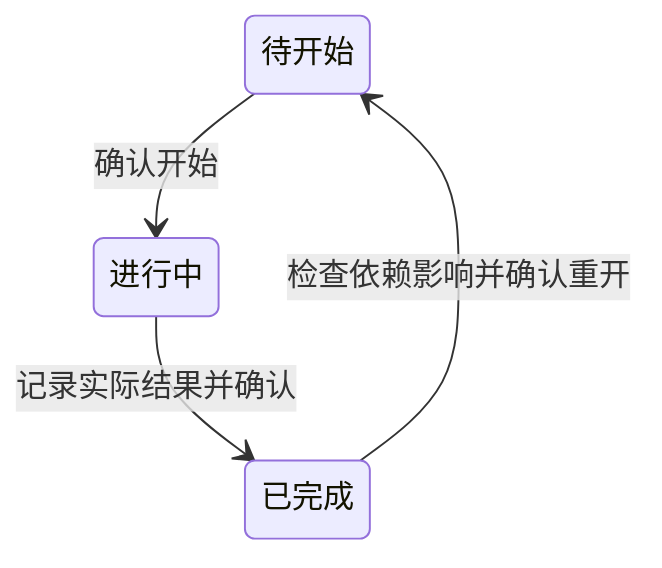

# 总控台任务状态方案

2026-11-11 · 本地候选方案。目标是让用户看清任务处在哪个阶段、为什么现在不能执行，以及修改后会影响哪些任务。打开样例即可走通查看、开始、登记阻塞、解除、完成、重开和撤销。[交互样例](index.html) · [状态转移 UI 规范](../../../standards/interface-capability/state-transitions.md)

## 现有数据与候选改动

总控台当前保存任务的 `kind`、`status`、`deps` 与 `output`。`status` 包含待开始、进行中、阻塞中和已完成，`output` 在现有数据中可以是计划成果。现有写入校验限制缺失和循环依赖，Agent 提交另查完成条件。旧阻塞记录仅凭 `status` 无法知道阻塞前的阶段。[现有字段校验](../../../../project-console/.sites-checkout/app/validate.ts) · [Agent 提交校验](../../../../project-console/.sites-checkout/app/agent.ts)

| 信息 | 来源 | 谁能改变 |
| --- | --- | --- |
| 承诺程度 | 待验证想法、暂定方向、已承诺任务 | 业务决策。确认承诺是独立操作。 |
| 执行阶段 | 待开始、进行中、已完成 | 显式确认开始、完成、重开。 |
| 前置条件 | 按当前依赖和各任务完成情况计算 | 前置记录变化后重新计算。 |
| 人工阻塞 | 原因和登记状态 | 有原因地登记，显式确认解除。 |
| 查看位置 | 原任务和实际走过的依赖路径 | 切换任务、查看前置、沿路径返回。 |

人工阻塞可以叠在待开始或进行中。旧记录保留「原执行阶段待确认」，解除时由用户补记。前置变化只重算当前条件，已有执行阶段保留。计划产出与实际完成说明分别呈现。

## 操作和守卫

| 操作 | 允许条件 | 结果与提示 |
| --- | --- | --- |
| 查看前置／返回 | 依赖存在且路径上未重复，或返回已访问祖先 | 只更新查看对象。缺失记录显示具体标识，循环回边显示原因。新对象标题获得焦点。 |
| 开始 | 已承诺、待开始，依赖有效且全部满足，人工阻塞已解除 | 确认后进入进行中。 |
| 登记阻塞 | 已承诺且处于待开始或进行中，填写原因 | 原阶段保留，当前动作变为解除阻塞。 |
| 解除阻塞 | 已登记人工阻塞。旧记录须明确补记原阶段 | 只清除人工阻塞。若还有待满足前置，预告与结果都说明仍需等待。 |
| 记录完成 | 已承诺且进行中，依赖有效且全部满足，人工阻塞已解除，填写实际结果或产物位置 | 记录完成并重算后续任务条件。后续任务仍由用户显式开始。 |
| 重新打开 | 已完成，且没有已完成的直接依赖方 | 预告直接影响后回到待开始，未完成的依赖方重新等待。若已完成的依赖方存在，给出查看入口，避免静默撤销其完成记录。 |
| 取消／撤销 | 取消发生在预览中。撤销用于样例中最后一次确认 | 取消保留当前记录并把焦点还给触发按钮。撤销恢复本轮内存快照。 |

本次选择「显式开始、显式完成」来区分实际进度与排期条件。重开选择先处理已完成依赖方，当前规模下能把影响交给用户逐项确认。批量联动如果进入产品范围，需先定义级联预览、授权与撤销。当前数据模型假定已完成记录的直接前置均已完成，因此保护已完成的直接依赖方可维护这项约束。导入不一致数据时应进入核对流程。

## 生产接入条件

当前样例使用内存数据和最后一次修改的快照，刷新后重置。接入真实总控台需增加人工阻塞原因、实际完成依据和旧阶段迁移策略。提交时由服务端重新检查对象 revision、权限、依赖和守卫，成功后返回可核对的新状态。并发冲突保留用户草案，显示现值与拟改值。真实撤销以补偿变更执行，重新检查已发生的下游动作。[总控台写入规划](../../../../project-console/.sites-checkout/planning/overall-plan.md)

## 复查

在浏览器直接打开原型。先选「执行中受阻」，尝试解除并观察剩余前置。再选「可开始」，依次开始、登记阻塞、解除、填写完成结果。用「已有完成的依赖方」核对重开限制。`node scripts/check-state-study.mjs` 使用本机 Edge 与 Playwright 重跑自动检查。当前已通过九类样例、五档屏宽、键盘下钻、确认、取消、错误提示及撤销。视觉偏好与辅助技术体验仍待用户审阅。[验证记录](../../../runs/state-study/verification.json)
