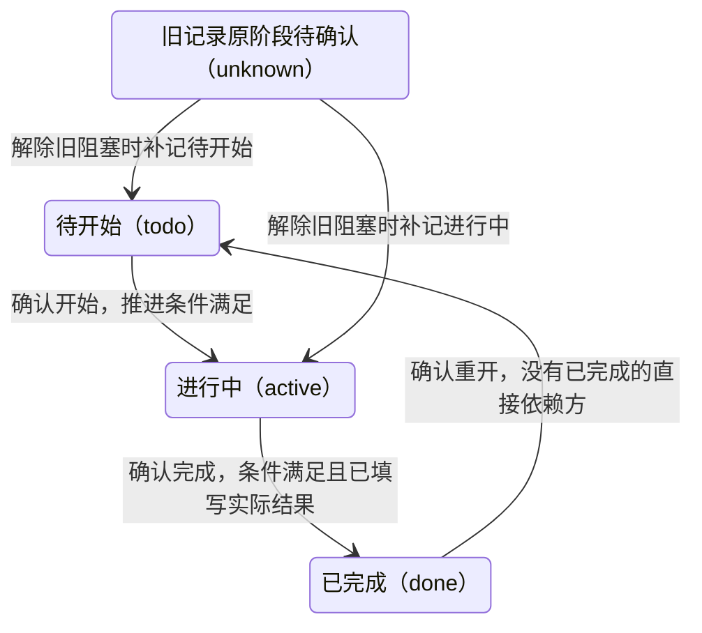
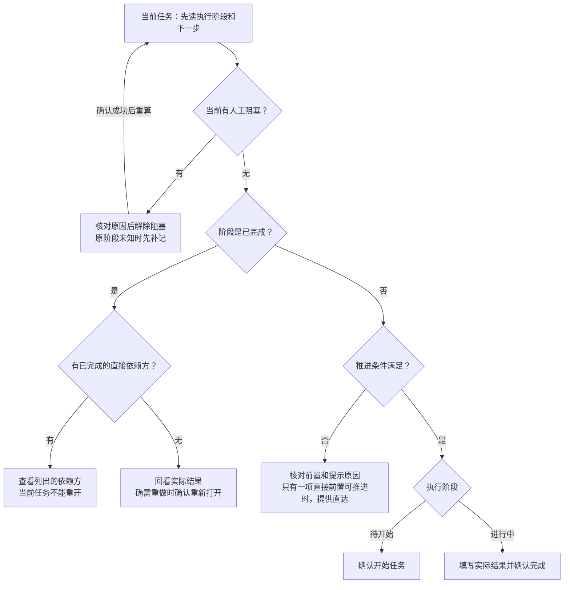
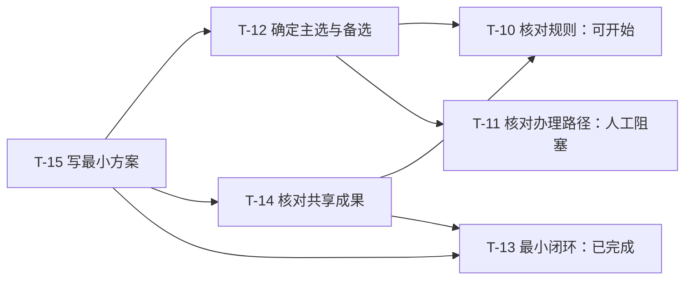

# 工作台的数据与操作规则

2026-11-15 / 对应 [当前离线工作台](index.html) 和 [实测实现版本](../../../runs/project-workbench/state-clarity/verification.json)。

## 数据存在哪里

打开页面时，`index.html` 依次加载 `prototypes/data.js`、`state-study/model.js` 和 `workbench/app.js`。样例文件里的 `window.DEMO_TASKS` 是初始记录。工作台补上演示用的承诺字段，套用 URL 指定的场景，再通过 `TaskWorkflow.fromRecords()` 转成当前页面的 `tasks` 数组。确认操作只替换这个数组中的目标任务，成功后重建索引并刷新页面显示。刷新或另开标签页会从样例重新开始。 [HTML 入口](index.html) · [初始记录](../prototypes/data.js) · [工作台逻辑](app.js) · [共享任务模型](../state-study/model.js)

| 放在哪 | 内容 | 谁会改它 |
| --- | --- | --- |
| 源码样例 `DEMO_TASKS` | 固定任务记录。旧记录以 `status` 表示阶段或「阻塞中」。 | 修改样例源码才会改变下一次加载的初始数据。 |
| 页面内存 `tasks` | 任务身份、归属、承诺、依赖、计划产出、执行阶段、人工阻塞、完成记录。 | 提交通过共享模型的校验后替换目标记录。 |
| `byId` 与 `info` | 任务索引，以及从当前任务数组计算的直接前置、未满足项、缺失与循环、是否可推进。 | 加载和每次成功提交后重算。 |
| `view` | 当前项目筛选、状态筛选、从起点到当前对象的依赖路径。路径条目包含需要恢复的滚动位置和展开状态。 | 选择任务、下钻、返回或筛选时更新。 |
| `draft` 与确认表单 | 拟操作的任务 ID、动作、触发控件以及用户正在填写的值。 | 打开确认时创建，校验失败继续留在表单，取消或成功后结束本次草案。 |

项目清单位于工作台脚本中，包含 `id`、`priority`、`name`、`status`，用于项目概览和筛选。任务用 `project` 关联项目，依赖边用 `deps` 里的任务 ID 指向另一条任务记录。

### T-12 的页面内存对象

默认加载后，工作台为 T-12 使用当前版本的标题和计划产出。以下为规范化后的完整对象。

```json
{
  "id": "direction",
  "code": "T-12",
  "title": "确定竞赛主选与备选方向",
  "project": "ic",
  "kind": "已承诺任务",
  "deps": ["rules", "mentor"],
  "output": "各列一项主选和备选，附选择依据与暂缓条件。",
  "phase": "todo",
  "blocker": null,
  "completion": ""
}
```

`id` 用于索引和依赖，`code` 是界面编号。`output` 记录计划产出，`completion` 记录确认完成时输入的实际结果或产物位置。这里 `blocker: null` 表示 T-12 自身没有人工阻塞。它仍等待 T-10 和 T-11，因为 `deps` 指向的两项尚未完成。T-11 的人工阻塞存在 T-11 自己的记录里。

## 图一｜任务执行阶段

箭头表示确认后的内存变更。完整的前置和输入条件见下方决策表。



人工阻塞是同一任务的独立字段。登记在 `blocker` 写入 `{reason}`，解除将其设回 `null`。已知执行阶段在登记和解除时都保留。图中 `unknown` 的两条箭头适用于带人工阻塞的旧记录，补记阶段与解除同时确认。查看前置、返回、筛选、打开确认框、取消和输入校验失败都保持任务数据原样。

## 图二｜在当前任务上怎么选下一步



**推进条件 `ready` 的实际计算**是承诺为「已承诺任务」、原阶段已知、自己没有人工阻塞、所有直接前置都为 `done`，并且从当前任务可达的依赖链没有缺失或循环。直接前置数与图完整性分别计算。一个任务即使显示「0 项直接前置待满足」，只要仍有人工阻塞、缺失引用、循环或阶段未知，就可能无法推进。

等待项的主提示优先显示具体原因与前置入口。对于已承诺、阶段已知、未完成且没有人工阻塞的任务，「登记阻塞」仍可用，即使它正在等待前置。它用于记录另一条实际发生的人工限制。

### 按钮决策表

| 操作 | 何时接受确认 | 写入什么 | 失败或后续 |
| --- | --- | --- | --- |
| 开始任务 | 执行阶段为 `todo`，推进条件满足。 | `phase = active`。 | 条件不足先查看原因。条件后来满足时，仍需显式开始。 |
| 记录完成 | 执行阶段为 `active`，推进条件满足，实际结果去首尾空白后长度为 1–500。 | `phase = done`，`completion = 实际结果`。 | 缺结果时在原表单提示。依赖方重算资格，执行阶段保持原样。此版本校验文本长度，填写的产物位置由操作者核对。 |
| 登记阻塞 | 已承诺，处于 `todo` 或 `active`，当前无人工阻塞，阻塞说明去首尾空白后长度为 1–500。 | `blocker = {reason}`，保留 `phase`。 | 阻塞和前置等待可同时存在。 |
| 解除阻塞 | 当前有人工阻塞。旧记录阶段为 `unknown` 时，要选 `todo` 或 `active`。 | `blocker = null`，旧记录补记所选阶段，已知阶段保留。 | 解除成功后重新判断推进条件，仍缺前置时继续显示等待。 |
| 重新打开 | 当前为 `done`，且不存在引用本任务并且已完成的直接依赖方。 | `phase = todo`，清空该任务的 `completion`。 | 已完成依赖方存在时，界面列出编号，模型也拒绝提交。其它依赖方重新计算推进条件，原阶段保留。 |
| 查看前置 / 返回 | 下钻目标来自当前任务的真实 `deps`，目标存在且未出现在当前路径中。返回目标是路径里的已有祖先。 | 仅更新 `view.path` 和焦点，保留筛选。 | 缺失、循环回边就地标出。返回原入口和滚动位置，入口已改变时回到任务标题。 |

所有业务按钮先打开预览，确认时由 `transition()` 再读取内存状态并校验。取消返回触发控件。提交失败保留表单中的输入。提交成功更新当前任务、队列和计数，并显示新状态或新解锁的任务；解锁后的任务仍由用户自己开始。

## 用 T-12 验证操作

以下箭头是依赖关系，方向是「左侧任务等待右侧任务」。



1. **从 T-15 查看 T-12，再选择「查看可推进的 T-10」。** 确认开始，填入实际结果后确认完成。返回 T-12，此时直接前置剩 T-11。
2. **打开 T-11，解除人工阻塞。** 补记阻塞前的真实阶段。若选择待开始，随后仍要显式开始，再记录实际结果。解除本身只恢复阶段和资格。
3. **返回 T-12。** 它现在可以开始，仍处于待开始。确认开始，再记录主选、备选及依据。T-15 此时仍等 T-14。
4. **回到 T-15 核对 T-14。** 样例中 T-14 已在进行中，T-10 完成后具备记录完成的条件。T-14 完成后，T-15 可开始，等待用户确认。

[开始试用](index.html) · [直接前置标记为完成的反例](index.html?scenario=clear) · [进行中解除阻塞后仍等待](index.html?scenario=blocked) · [重开被已有完成依赖方拒绝](index.html?scenario=downstream)

直接前置标记为完成的样例中，T-12、T-14 自身仍有前置待满足。当前守卫会放行 T-15，已作为数据完整性问题登记。 [反例复现及验收条件](workflow-review.md)

## 验证范围

现有浏览器记录覆盖完整的 T-10／T-11 → T-12 → T-15 路径，以及解除阻塞后仍等待、缺失引用、循环和重开拒绝。重新运行行为校验对照了两条实测轨迹和当前源码哈希。另在离线 Edge 里确认，同页启动 T-10 后，第二标签页和原页刷新均恢复样例的「待开始」。 [验证报告](../../../runs/project-workbench/state-clarity/verification.json) · [契约](behavior.json) · [实测轨迹](../../../runs/project-workbench/state-clarity/observed.json)

本页图表描述当前离线实现。产品候选 v0.2 里的持久化、并发版本校验、审计和补偿撤销还属于单独的产品方案。当前样张的重开会清空完成说明，历史结果保留需要另外实现。 [产品状态方案](../state-study/state-model.md)
