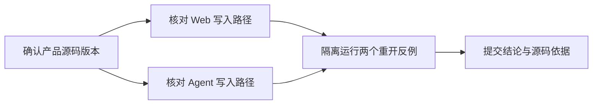

# PC-01 核对 Web 与 Agent 的任务重开规则

## 任务说明

真实试点。对照两条产品写入路径，判断存在已完成下游时是否允许重开前置。

## 跨任务前置

无直接前置任务。

## 执行步骤

[在浏览器查看步骤图](index.html#steps)

## 交付标准

给出两条写入路径的观察结果、源文件和版本，并保留已完成下游与进行中下游的对照。

## 相关资料

- [试点记录](../../task-entry.md)
- [实际提交的结果](../../../../../runs/project-workbench/task-entry/record.json)
- [隔离验证输出](../../../../../runs/project-workbench/task-entry/guard-probe.json)
