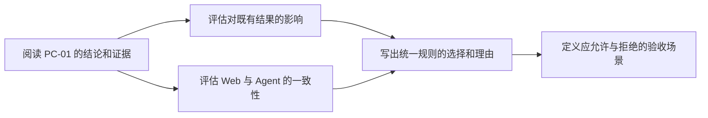

# PC-02 评估是否统一 Web 与 Agent 的重开规则

## 任务说明

根据 PC-01 已提交的证据，判断哪条重开约束应成为共同的产品规则。

## 跨任务前置

- [PC-01](../PC-01/README.md)

## 执行步骤

[在浏览器查看步骤图](index.html#steps)

## 交付标准

写出守卫、拒绝原因和恢复路径。PC-02 是后续评估入口，当前展示 PC-01 的原始结论供查证。
