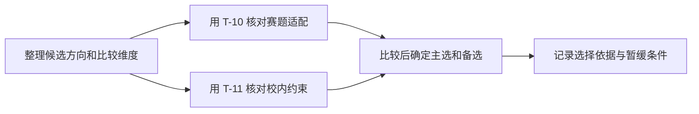

# T-12 确定竞赛主选与备选方向

## 任务说明

各选一项主选和备选，交代做这个选择的依据和何时应暂缓。

## 跨任务前置

- [T-10](../T-10/README.md)
- [T-11](../T-11/README.md)

## 执行步骤

[在任务页查看内嵌步骤图](index.html#steps)

## 交付标准

主选、备选各一项，有可追溯比较依据和暂缓条件。图里的准备步骤是建议工作顺序，工作台当前的开始和完成守卫以任务详情为准。

## 相关资料

- [独立打开 Archify 步骤图](archify.html)
