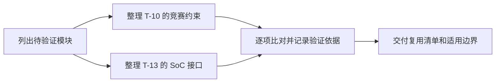

# T-14 验证竞赛与个人 SoC 能否共享成果

## 任务说明

对照竞赛限制和 SoC 最小闭环，判断哪些成果可复用以及适用条件。

## 跨任务前置

- [T-10](../T-10/README.md)
- [T-13](../T-13/README.md)

## 执行步骤

[在浏览器查看步骤图](index.html#steps)

## 交付标准

给每个候选模块注明可复用、不适用或待验证，标明证据和仍需处理的限制。
