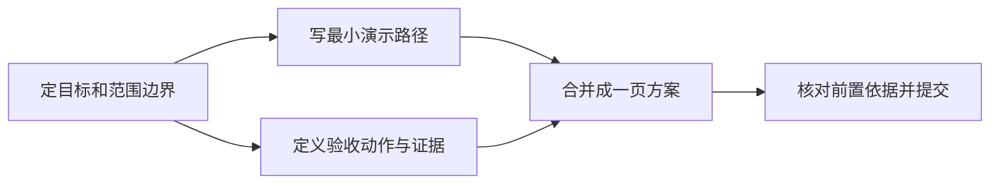

# T-15 写下最小方案与可检验的验收标准

## 任务说明

把选定方向、共享边界和 SoC 接口整理成一页可检验的实施方案。

## 跨任务前置

- [T-12](../T-12/README.md)
- [T-14](../T-14/README.md)
- [T-13](../T-13/README.md)

## 执行步骤

[在浏览器查看步骤图](index.html#steps)

## 交付标准

一页方案包含目标、非目标、演示与验证方法；最少能用指定动作和证据判断演示是否达标。
