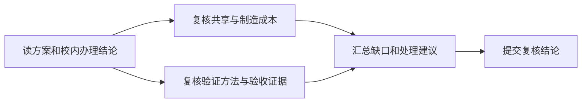

# T-17 复核方案的共享、成本与验收约束

## 任务说明

复核方案是否明确记录跨项目共享、制造成本、验收证据和校内办理约束。

## 跨任务前置

- [T-15](../T-15/README.md)
- [T-11](../T-11/README.md)

## 执行步骤

[在浏览器查看步骤图](index.html#steps)

## 交付标准

区分已满足、待补证据和需修改的约束。每条缺口都能追到具体方案位置。
