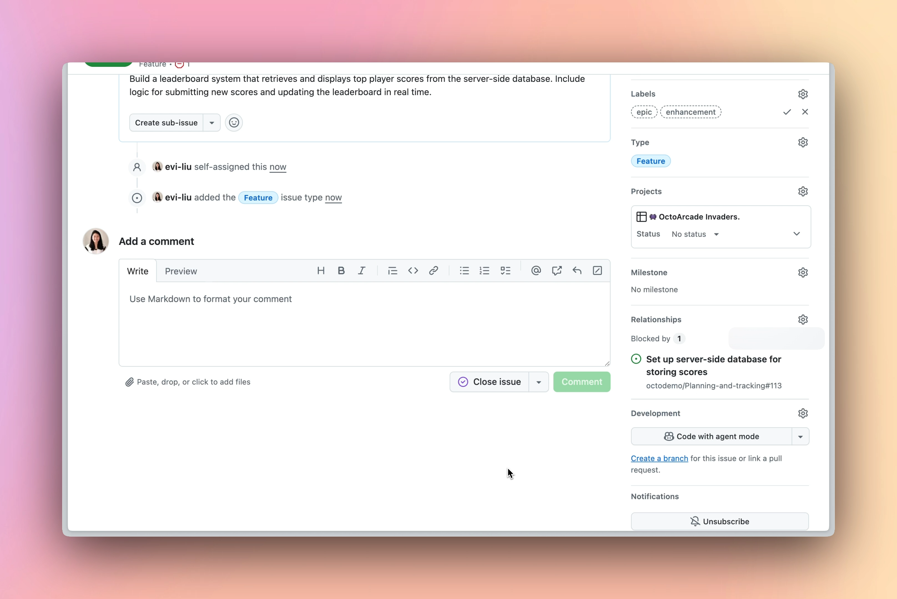
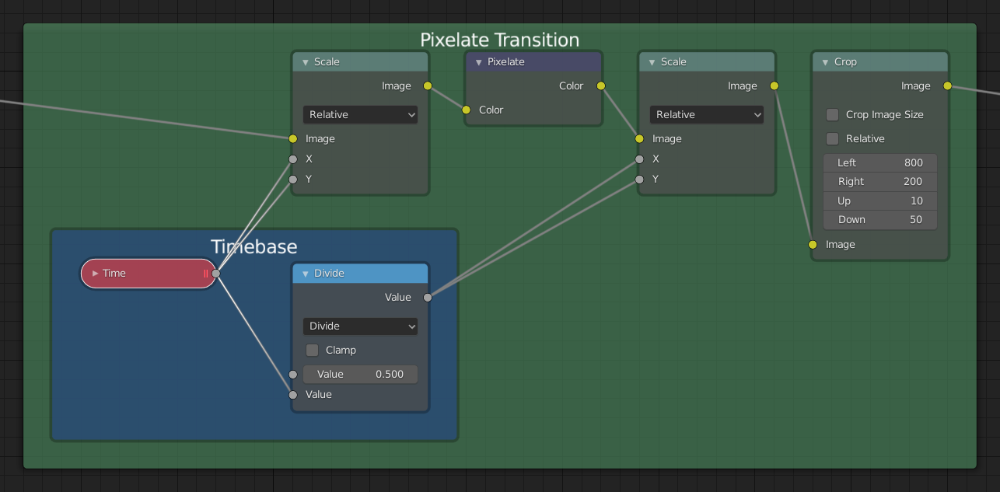

# X01—X03：跨产品的关系、分组与返回

2026-11-11。三个独立来源家族的定向资料对照，目标仍为同一个迁移任务：阻塞与依赖导航。不是新增三次真人体验或完整原产品验收。[来源与媒体清单](sources.json)。

## Key Screens

### X01 GitHub：建立／移除阻塞关系

X01-S01 官方文档区分“被谁阻塞”和“阻塞谁”；X01-S02 官方演示显示右侧关系入口及提交后的对象列表，发布于2025-08-21。原片9.2秒的编码时间不是点击延迟；图中的渐变画框来自宣传视频，不能当作产品 UI。媒体重新下载比对哈希；没有使用私人账号。

### X02 Blender：视觉 Frame 与可复用 Group

X02-S01 的官方静态示例可见嵌套的绿色／蓝色 Frame、大区标题和节点连接。Frame 帮助组织空间，**框内相邻不自动成为逻辑依赖**。X02-S02 的 Node Group 则封装输入输出和可复用逻辑；文档禁止递归组。使用4.5 LTS手册，不宣称反映所有后续版本。

### X03 GOV.UK：核对答案→更改→返回核对→确认

X03-S01 的公开模式以摘要行与就近 Change 入口组织内容，底部确认动作与单项更改分开。采集过程中留下的 govuk-check-answers.png 未完整记录截图程序，保留为暂存证据，不独自支持研究判断；本例行为依据可回看的官方页面。

## Experience Notes

| 对照 | 支持什么 | 反对何种过度迁移 |
| --- | --- | --- |
| GitHub | 对象旁明确关系方向；建立关系与执行状态分开 | 不能把访问历史渲染成数据边；也不必为依赖任务提供完整空间画布 |
| Blender | 层次可以来自有色分区、嵌套与标题尺度；分组与逻辑封装有不同语义 | 同色框、项目分类和节点相邻都不证明因果；程序节点的递归禁令不直接等于所有任务系统规则 |
| GOV.UK | 更改时保留已输入信息，结束后直返核对页；最终确认边界明确 | 不能把所有工作导航都套成逐步表单，或声称核对页天然实现数据库撤销 |

与终末地对照：对象身份、原因入口与关系方向在新家族中仍有设计理由；切角、酸黄、游戏式编号和地图布局没有因此获得普适依据。GOV.UK 的克制阅读与 Blender 的有色嵌套可以同时合理，说明“层次如何做”必须根据工作内容选择。

## Motion Specification

GitHub 有官方连续演示，已保留五个采样状态及编码时间；输入时机、网络延迟和取消未逐项测量。Blender 与 GOV.UK 仅静态示例／指导，没有可迁移的动效时长。新小样动效是原创参数，须支持减少动态效果。

## Interaction Flow

| 来源／转换 | 资料支持与缺口 |
| --- | --- |
| GitHub issue→Relationships→选关系方向→搜索／选对象→关系结果 | 文档流程＋官方短演示；移除关系的取消勾选是文档声明，未实机操作 |
| Blender 选节点→加入 Frame→调整分区／移出 | 手册声明；示例是静态结果，未录制拖动、焦点或恢复 |
| Blender 节点集合→Group→输入输出接口→复用 | 手册声明；与 Frame 分开理解，未实际建组 |
| GOV.UK 核对→Change→预填内容→Continue→直返核对→最终确认 | 官方模式要求；没有执行真实交易或验证后端事务 |

## 迁移结论

保留“真实关系可核对”“查看与修改分开”“返回保留上下文”；将表面、配色、字体和关系布局留作有条件的选择。新规范必须写适用条件、实现自由度与反例。三家资料彼此不构成真人可用性互证；后续用不同数据情境检查目标原型，不能把来源数当作泛化成绩。
