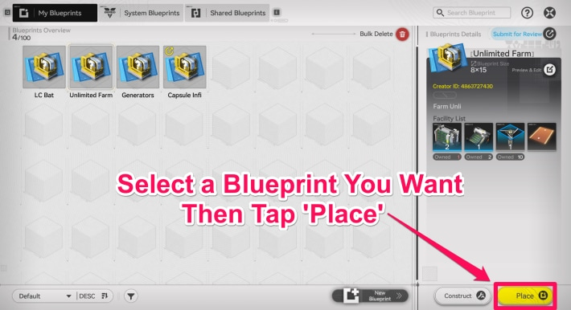
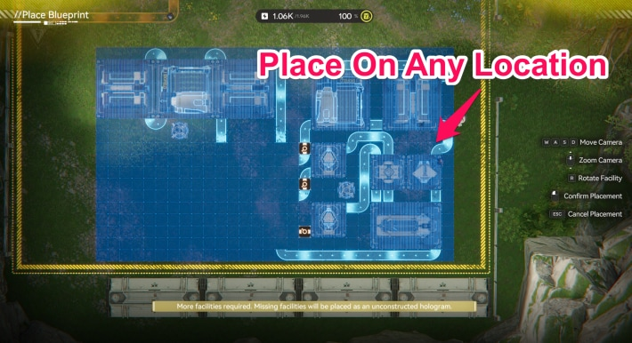
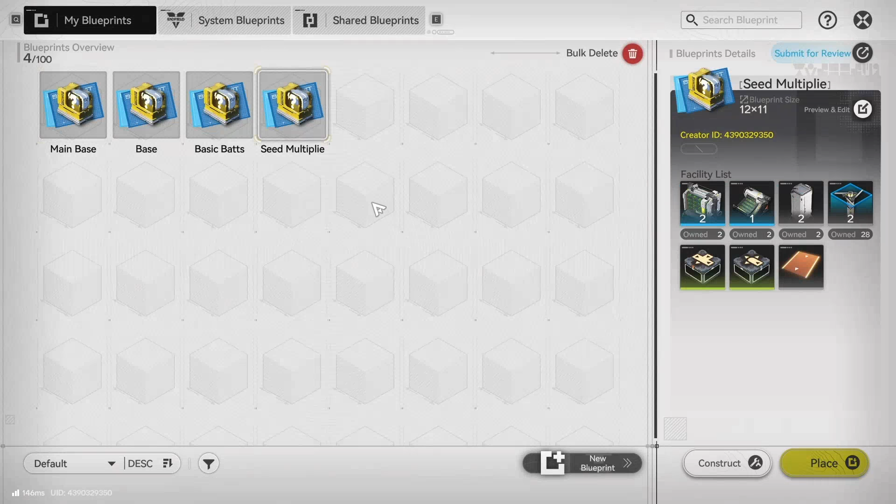
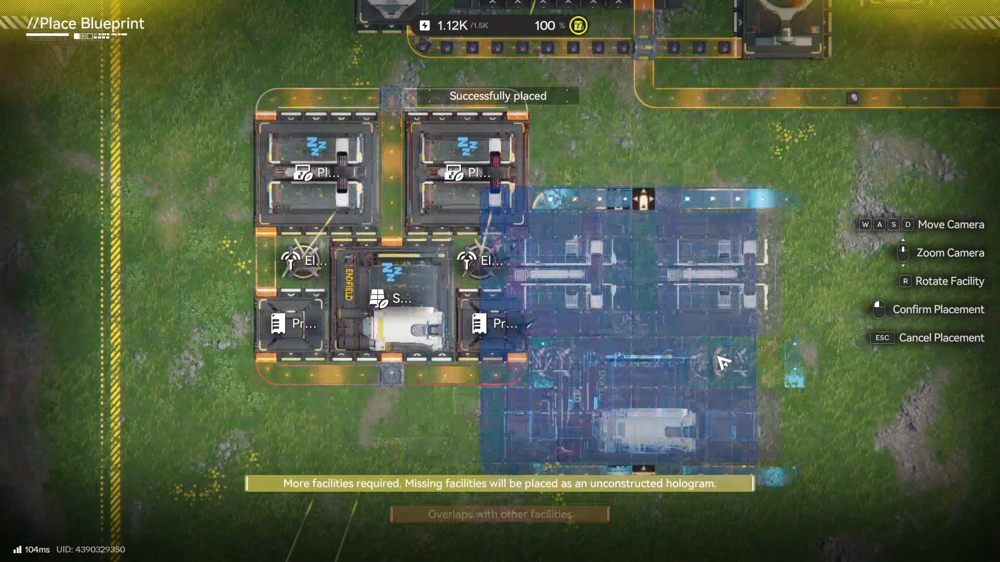

# DCL-C09：蓝图从选择到放置，预期与结果如何区分

研究日期：2026-11-11。状态：**partial**。已取得作者10.349秒原始发布片段，观察到“进入列表→换选对象→放置预览→Successfully placed”及继续放置状态。取消后的恢复仍缺；未实测游戏或用户体验。

## 来源、边界与研究问题

- C09-S01：[GameWith蓝图指南](https://gamewith.net/akendfield/72615)，“How to Use Blueprints”段落，作者为攻略团队。本文关注其两张顺序截图及首步内嵌的实际操作短视频，不研究目录中的全部工厂布局。
- C09-S02：[Dot Esports蓝图指南](https://dotesports.com/arknights-endfield/news/arknights-endfield-blueprints)，Edward Strazd，2026/01/23；提供创建／使用步骤与缺设施、未研究技术的区别。图片下载返回HTTP451，未绕过限制，未将该图当本地证据。
- C09-S03：[GamesFuze创建保存指南](https://gamesfuze.com/guides/create-save-1-blueprint-in-arknights-endfield/)，Andrés，标示2026/01/27更新；作为创建过程的作者说明，未独立运行验证。

精确游戏build和操作设备未知；网页更新时间不等于截图采集时间。原图、失败下载与SHA256见[sources.json](sources.json)。

## 1. Key Screens



KS01可见左侧对象集合、右侧当前对象详情和需求列表，右下主要动作。粉红文字、箭头与框是攻略作者批注；游戏本身主动作是黄色，其他操作权重较低。只有当前对象显示详情，避免每个列表项同时展开全部信息。



KS02中场地、边界、半透明蓝色设施布局同时可见；右侧列出移动、缩放、旋转、确认和取消的操作提示。底部黄带提示设施不足时将留下未构筑部分。图中文字和剪辑无法证明此后确实点击确认或按取消。

补采[原始发布短视频](evidence/blueprint-open.mp4)，1920×1080、10.349秒。8个解码采样帧均已视觉核查，时间仅属于发布片段；[列表/预览采样记录](evidence/open-frames/capture.json)、[末段加密采样记录](evidence/result-frames/capture.json)。





片段实际可见次序：0秒是AIC场景与右侧Blueprints入口；约2.070秒显示列表且选中Main Base；约4.140秒选中Seed Multiplie，右侧名称、12×11尺寸、设施种类与库存随之改变；约6.209秒已进入俯视放置，蓝色预览保留；8.279、9.000秒预览位置继续改变；9.700与10.300秒出现Successfully placed，左侧设施成为实体，右侧仍有下一次蓝色预览、Confirm Placement和Cancel Placement。画面底部仍显示缺设施说明，成功消息不能证明生产线已运行；实体上可见Zzz，也不能仅凭该图推定停运原因。9.700秒短暂还出现Overlaps with other facilities，说明连续放置会立即面对新的位置约束。

## 2. Experience Notes

| 实际可见证据 | Agent解释 | 检验条件／反例 |
| --- | --- | --- |
| 对象列表与详情分栏，放置动作邻近需求信息 | 先建立“我要用哪一个、需要什么”，再切入空间操作 | 长蓝图名称或大量设施可能挤压信息；需要更多变体而不是仅用这一短列表示例 |
| 蓝色投影叠在实际场地上 | 预览与已经建成具有不同视觉状态 | 半透明不应让“这是待确认”只靠颜色猜测；需要明确模式名称与退出路径 |
| 缺设施提示保留在预览时 | 不满足条件可分为硬阻止与部分待补齐，不能统一报错 | 部分成功可能被误解为全部完成；后续结果页必须交代剩余工作 |

新增视频支持一个更细的区别：**一次提交成功、退出操作模式、全部设施齐备、生产实际运行是四种状态**。成功消息与下一次投影共存，若总控台支持连续批量行为，应明确本次已提交对象和当前尚未提交对象，保留取消当前预览的入口；不能让取消被理解为撤回之前成功操作。

本例最有价值的区分是“选择方案”“预览影响”“提交变更”“仍待补齐”。这些阶段不应只用一个漂亮的成功动画覆盖。

## 3. Motion Specification

补采片段支持列表选择、详情更新、放置预览、成功反馈的可见次序。采样在9.000秒仍为预览、9.700秒已有成功提示，可将状态变化限定在发布片段这个区间；这不是输入延迟、动画持续时间或设备性能测量。没有原始按键/鼠标按下时点，未测缓动、旋转插值、取消过渡与人类体验。

## 4. Interaction Flow

| 状态／转换 | 来源支持 | 未覆盖 |
| --- | --- | --- |
| S0蓝图列表→S1当前对象详情 | 同一片段2.070/4.140秒选中对象和右侧内容不同 | 原始输入时间与逐帧更新边界 |
| S1→S2放置预览 | 同一片段4.140秒列表→6.209秒俯视蓝色投影 | 实际输入时间与过渡持续时间 |
| S2→S3确认应用 | 同一片段9.700/10.300秒出现成功提示、实体设施与下一次预览 | 点击瞬间、可撤回历史和完整运行结果 |
| S2→S1取消 | 图中存在Cancel Placement提示 | 返回时位置、选择及筛选保留 |
| S3→S4补齐缺项 | 作者文字描述不足时需后续构筑 | 同一次操作下的完成／失败差异 |

## 对总控台的迁移

候选局部草图：

```text
当前任务：形成主选方案
预览追踪范围：[仅直接前置] [完整依赖链]
将展开：4项任务／2个项目；有1项资料缺失
[查看依赖] [返回原任务]
```

这里借鉴预期管理，不自动增加批量改任务状态的功能。若后续真有修改，应另设变更预览、影响清单和明确提交，不能把“查看链路”设计成会写入数据的动作。

反例：简单查看两个前置对象不需要多一步确认。只有操作有实际成本或副作用时才需要确认阶段；过度模仿游戏建设流程会拖慢总控台。建议局部样张中比较“直接展开”和“先概览再深入”，而非两版相同弹窗换皮。

完成缺口：本轮已补齐一次成功应用的同片段结果；部分构筑的具体结果、取消返回和最终运行仍缺同条件行为证据，因此尚不计完整交互案例完成。回到[项目入口](../../README.md)。
