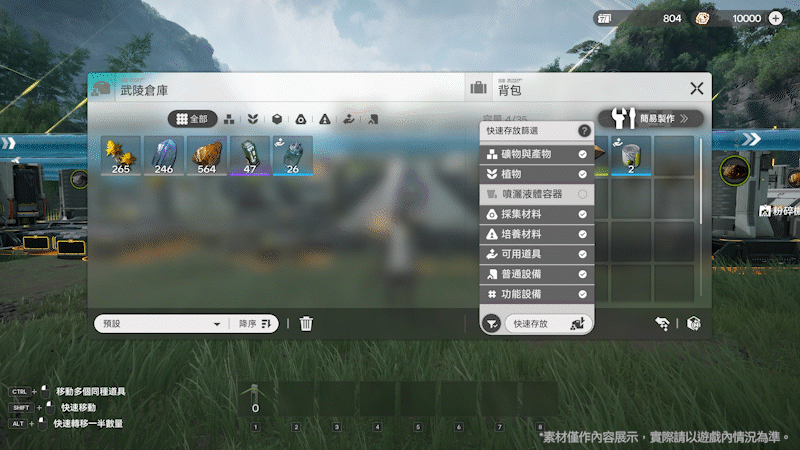
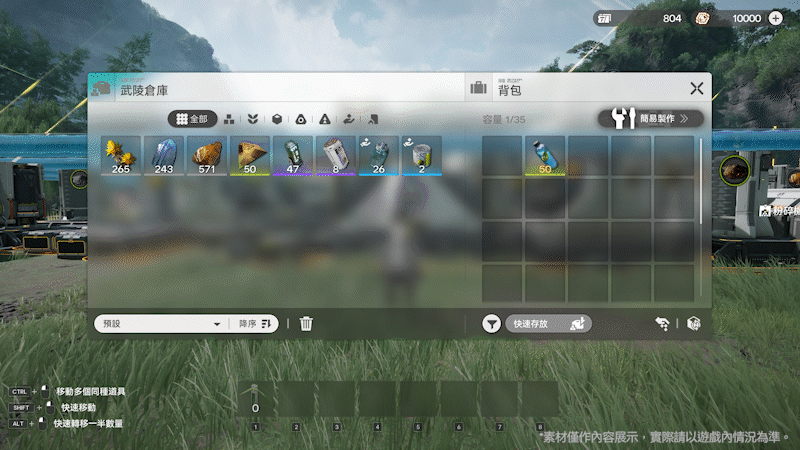

# DCL-C05：快速存放的范围选择与结果

研究日期：2026-11-11。研究记录已形成；按十例计划的完整流程标准仍为 **partial**：核心“调整过滤 → 执行 → 查看结果”有连续官方 GIF 支持，取消与重新打开过滤器后的保持行为未覆盖。不是真人可用性测试。

## 情境、来源与边界

目标：把可存放物移入地区仓库，同时保留液体容器用于探索。原始演示从过滤菜单已经打开的状态开始。来源为[2026 年官方开发组通讯](https://endfield.gryphline.com/zh-tw/news/2662)“快速存放筛选”段落的 GIF。它是历史版本改动预览，不证明采集日客户端完全相同；鼠标提示可见，真实设备与 build 未确认。来源与所有素材哈希见 [sources.json](sources.json)。

## Key Screens / 关键画面

原始 [GIF](evidence/quick-stash-official.gif) 为800×450、33帧，编码帧间隔均80ms，一圈2.64秒。下列时间是媒体编码位置，不是游戏引擎响应延迟；提取帧未经批注或裁切。

| ID | GIF 帧／编码时间 | 直接观察 |
| --- | --- | --- |
| KS05-01 | [0／0ms](evidence/frame-0.png) | 左仓库右背包，中央偏右过滤菜单列出类别，条目右端带勾选状态 |
| KS05-02 | [8／640ms](evidence/frame-8.png) | 喷洒液体容器条目的勾选外观发生变化，其余选项仍可见 |
| KS05-03 | [16／1280ms](evidence/frame-16.png) | 菜单关闭，背包显示4/35；可见四个物品格，底部保留快速存放入口 |
| KS05-04 | [25／2000ms](evidence/frame-25.png) | 背包仍4/35，快速存放入口可见 |
| KS05-05 | [32／2560ms](evidence/frame-32.png) | 背包变为1/35，只余蓝色容器50；左侧出现移入的物品格 |

## Experience Notes / 体验观察

这是 Agent 回看媒体所得观察，没有体验者的主观反馈、犹豫或错误率数据。

- **结构性分隔**：左右两个库存区共用一个界面，操作后能同时观察来源减少与目标增加，减少只靠成功提示猜结果的需要。这是可观察布局，不等于已验证用户更快。
- **美术承担范围语义**：上部图标用于类别浏览，弹出菜单用于批量规则，底部按钮用于执行；三种职责位置不同。半透明面板保留场景背景，主内容仍依靠浅底、网格和文字组织。需要警惕透背景对低对比文本的影响。
- **计数是结果证据**：从4/35到1/35及具体剩余物，比单独“已存放”能说明排除项仍在。必须区分“操作范围过滤”与“当前显示过滤”；隐藏不意味着已存放。
- **反例／代价**：若默认规则把日常所需物品也存走，快捷操作会放大错误。类别级过滤过粗也可能无法保护某一个特定道具；本 GIF 不能证明有逐件例外或撤销。

## Motion Specification / 动效说明

菜单可见到消失、物品集合变化由同一 GIF 连续支持；未观察到可可靠测量的复杂入场轨迹。编码的80ms采样分辨率及宣传剪辑不能直接转成产品应采用的时长。勾选变化位于f0—f8之间，菜单关闭位于f8—f16之间，存放结果在f25—f32间可见。实际按下、可输入时刻、长按保护、缓动、取消动画均未知。

## Interaction Flow / 交互流程

| 转换 | 证据 | 结论级别 |
| --- | --- | --- |
| 过滤菜单已开 → 改变喷洒容器选项 | f0→f8，官方段落说明 | 连续外观支持；具体输入设备事件未记录 |
| 菜单关闭 → 库存可操作状态 | f8→f16 | 连续外观支持；关闭触发方式未知 |
| 快速存放 → 库存4/35变1/35 | f25→f32，目标仓库同步变化 | 结果连续可见；不能据此推断真实延迟 |
| 取消／复开菜单 | 缺证据 | 未验证，不补造持久性 |

## 候选原则与总控台映射

**C05-P01：批量动作前让范围可解释，动作后让对象变化可核对。** 原因来自同屏库存和结果数量变化；适用于有明确集合边界的操作。不能仅显示一个“成功”数字就认定范围正确。

用于任务依赖导航的文字草图：`筛选：未完成前置 3/5 → 选中前置 A → 查看原因 → 返回原任务（仍显示3/5及隐藏2项入口）`。筛选只改变可见集合，不能将隐藏前置当作已解决，更不自动触发批量完成。

比较样例可用“只保留筛选后的列表”与“明确显示全量/可见计数的列表”；检验能否指出被隐藏的阻塞。未来用户测试前不填写效果分数。

局限与补采：同版本重新打开过滤菜单、取消执行、规则是否保留；这些是原题尚未完成项。继续以 [十次研究计划](../../docs/ten-case-study-plan.md)的标准登记。
