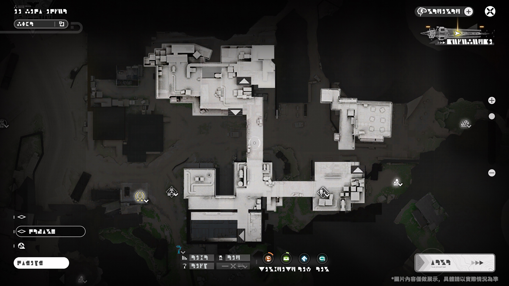
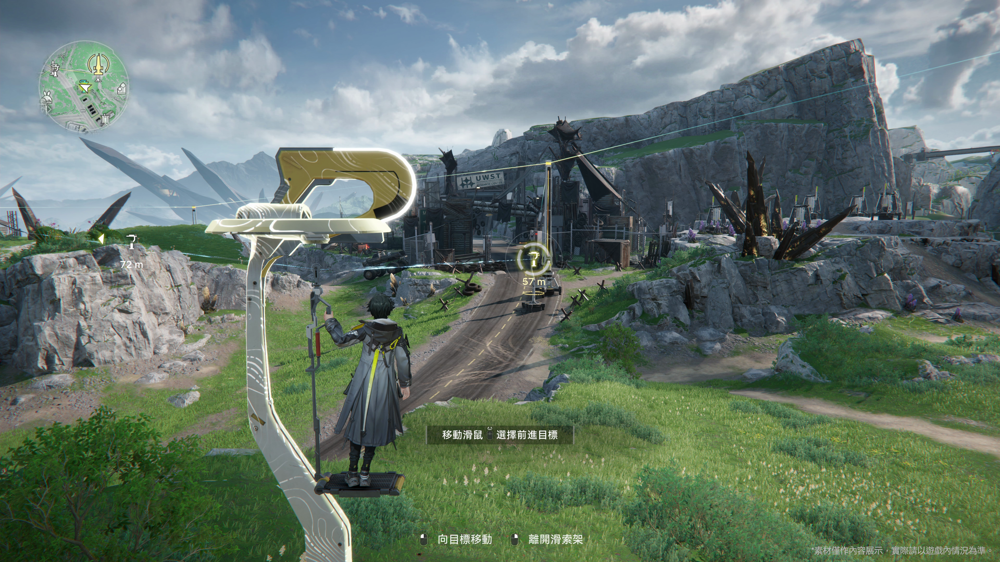
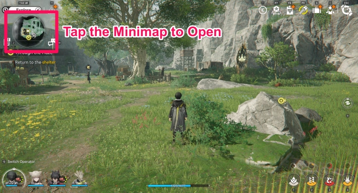
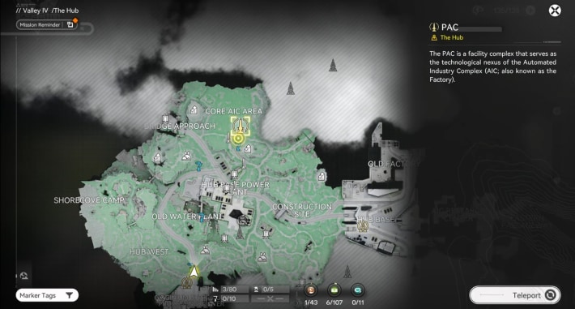
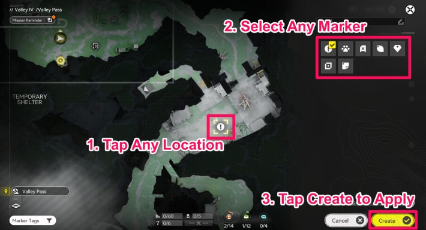

# DCL-C01：地图定位后返回行动

更新：2026-11-11。状态：本轮资料分析报告已完成（documentary_review: completed）；原定完整操作链仍部分覆盖（original_workflow: partial），没有完成连续交互或用户可用性验证。保留前两份官方预览，新增一份作者地图教程及三张来源图片。

本例属于首个风格实例“鹰角美术风格”，具体产品为终末地。拟观察的工作过程为“打开地图 → 选择目标 → 返回行动”；这是 Agent 根据现有项目范围和旧反馈选择的首个观察流程，尚不是已经发生的实验记录。迁移对象仍只有总控台的任务阻塞与依赖导航。

## 来源与适用版本

- **DCL-S01**：[官方「全面测试」开发组通讯//02](https://endfield.gryphline.com/zh-tw/news/1340)，页面显示发布于 2025/11/01 12:00，采集于 2026-11-10。定位到“新增其他系统与功能 → 分层地图与标记”。官方在该段介绍了地图层级切换与自定义标记。
- **DCL-E01**：上述段落链接的官方地图示意原图，1920×1080，约 1.01 MiB。原始 URL、字节数、SHA256、来源角色、访问失败记录均在 [sources.json](sources.json)。原图未经裁切或批注。
- **边界**：这是历史测试预览材料，图内另有展示用途声明。精确 build、平台、输入设备未知，不能作为 2026 年当前正式版的行为证明。
- 此前总控台的[案例分析](D:/Dev/projects/project-console/.sites-checkout/review/case-studies.md)主要观察终末地官网，不是本次游戏内地图操作的证据；旧正文继续原位维护。
- **DCL-S02 / DCL-E02**：[官方「新潮起，故渊离」开发组通讯](https://endfield.gryphline.com/zh-tw/news/2662)，本轮打开正文显示 2026/03/02 18:00，时区未标明；搜索摘要出现过不同小时数，登记以本轮打开的正文为准。定位“集成工业系统优化 → 滑索使用体验优化”。其中链接的 3840×2160 PNG 展示出发前的场景、小地图和目标提示；本地约 10.85 MiB，原图未经改动。它是版本改动的官方预览，不能证明采集日当前客户端的行为。
- 用户在另一会话提供的创作者资料已通过 [DCL 参考入口](../../references/README.md)接入。它们可提供制作方法和人类设计解释，不增加本例的实际操作次数。

## 1. Key Screens / 关键画面

**KS-01 → DCL-E01 → DCL-S01**：分层地图示意。

下列位置均按 1920×1080 原图描述，只用作可回看的区域定位。

| 观察 ID | 画面位置 | Agent 可直接观察到的内容 | 尚不能确定 |
| --- | --- | --- | --- |
| OBS-01 | 中央地图区域 | 中央建筑/通道呈明亮灰白，周围环境更暗，轮廓与图标叠加其上 | 明暗对应当前层、可达性还是其他状态；需要状态变化比较 |
| OBS-02 | 左下纵向控件组 | 同组有多个符号条目，其中一项有横向圆角描边，底部另有白底控件 | 每项的实际文字、语义、焦点与选择状态区别 |
| OBS-03 | 右侧中段与右上角 | 加减符号纵向布置；右上有独立的叉形符号控件 | 实际可点击范围、键位、缩放反馈、关闭触发条件 |
| OBS-04 | 地图上的散点与底部图标组 | 图标使用不同轮廓；局部有黄、蓝、绿、橙等强调色，底部有同类图标的并列分组 | 各颜色和形状的正式语义，以及是否存在冗余编码 |

不据该图猜测字体家族、完整文本、精确颜色 token 或尺寸规范。图中标签含无法可靠识读的造型字符；不将其补写成实际游戏文案。

**KS-02 → DCL-E02 → DCL-S02**：滑索出发前的方向选择场景。

这是一张静态 PNG；检查未发现 APNG 动画控制块。它与 KS-01 来自不同发布时期、不同展示场景，不能当作同一次交互的前后帧。

| 观察 ID | 区域 | Agent 可直接观察到的内容 | 解释边界 |
| --- | --- | --- | --- |
| OBS-05 | 左上角、主场景与底部 | 小地图、人物/场景、操作提示同时可见，主场景占画面大部分 | 共存可观察；小地图入口的实际点击、关闭和返回过程未观察 |
| OBS-06 | 场景中的两个候选位置 | 一处目标用黄色环和 57 m 距离强调，另一处为白色图标和 72 m；图标位于场景位置附近 | 可比较颜色、包围形状、位置及距离；不能由此推出玩家一定先看到哪一项 |
| OBS-07 | 中下与底边 | 有选择目标的鼠标提示，并区分向目标移动和离开设施的操作 | 图示采用鼠标操作提示，实际采集平台与设备未独立确认；响应速度未知 |

## 2. Experience Notes / 体验观察

目前只有 Agent 对静态原图／作者批注图的视觉观察及作者图文步骤，没有本轮真人操作记录、眼动、耗时或成功率。

| 假设 ID | 从证据到候选解释 | 对总控台的迁移问题 | 反例与检验条件 |
| --- | --- | --- | --- |
| H-01 | OBS-01 显示局部较亮、外围较暗的层次。候选解释：突出当前关注区域，同时保留周边上下文 | 查看阻塞任务的一个前置对象时，是否可保留原任务与依赖链作为背景？ | 变暗可能隐藏关键阻塞关系；后续比较“保留上下文”与单独详情的任务表现。静态图未证明效用 |
| H-02 | OBS-02/03 显示局部内容与边缘控件分布。候选解释：为对象查看保留稳定的操作位置 | 切换依赖对象时，返回、定位原任务和筛选条件能否保持可预测？ | 当前仅看到一个状态，尚不能证明位置跨状态稳定；必须检查连续转换 |
| H-03 | OBS-05/07 显示概览、局部对象及下一步操作共存。官方 S02 同时说明该调整用于出发前确认方向 | 展开一条任务依赖时，能否同时看见所属上下文、前置对象，以及继续追踪/返回原任务的动作？ | 信息过多可能相互争夺注意力；若关系复杂，局部提示可能掩盖多个并行阻塞，需要复杂依赖样例检验 |
| H-04 | OBS-06 中局部颜色、环形包围和数值共同区分候选对象；与地图整体的工业美术不是同一层语义 | 可否让局部强调承担“当前选中”，同时用文字/图标独立表达“阻塞状态”？ | 如果同一种颜色同时表示选择、警告和可执行，会产生歧义；需检查选中但未阻塞、未选中但阻塞等组合 |

它们是待验证的迁移假设，尚未升级为已验证设计原则，也没有据此修改总控台。

### 本轮设计判断：定位与行动要在同一情境中衔接

基于 OBS-05—07，Agent 的初步判断是：值得迁移的是“概览说明我在哪里、局部强调说明我正在比较谁、动作提示说明接下来能做什么”三种职责的配合。不要直接把小地图或黄色圆环移植到任务管理界面。

对总控台的一个可审阅候选是：选中任务后保留项目与原任务路径，在相邻区域突出一个前置对象，并给出查看该对象/回到原任务的动作；其余阻塞对象仍保持可发现。具体实现尚未决定，也未验证它优于列表。

结合用户跨会话反馈 DCL-FB01/02，评价不能只统计字段是否齐全：还应检查有无明确视觉重心、当前对象是否易辨认、操作是否改变合理的视觉关系。创作者 FAQ 对围绕主体组织视觉的解释提供方法参考，不能替代本案例中的体验验证。

后续对照样例应包含：一个前置、多个并行前置、长标题、查看已完成前置、返回时保留原筛选。观察能否正确指出阻塞原因与方向、找回原任务，以及是否误把选择状态当成阻塞状态；没有真实观察前不填写结果。

## 3. Motion Specification / 动效说明

尚未取得可逐帧核对的连续操作材料。以下均为未知：

- 打开地图的触发方式、延迟、过渡时长与中途可输入时机。
- 选择目标后焦点、图标、详情和视图位置怎样变化。
- 返回行动时是否保留目标、地图层级、缩放与先前位置。
- 取消、快速重复输入与减少动态效果的处理。

没有填写推测毫秒值；单张图和官方功能说明均不能证明上述行为。

## 4. Interaction Flow / 交互流程

下面是**待观察流程**，不是已观察状态机：

| 状态/转换 | 想核查的事情 | 当前证据状态 |
| --- | --- | --- |
| S0 行动场景 → S1 地图打开 | 入口可发现性、出现层级与默认焦点 | 缺连续证据；KS-01 仅提供一张地图外观 |
| S1 → S2 选择目标 | 目标确认、信息揭示、层级与位置关系 | 未观察 |
| S2 → S3 返回行动 | 选择是否保留，下一步方向是否清晰 | 未观察 |
| S2 → S1 取消选择 | 焦点和原位置是否恢复 | 未观察 |

补充：KS-02 支持“出发前场景可包含小地图与目标提示”的静态展示；S02 描述了该情境下可打开大地图的官方改动意图。两者均未记录真实触发到完成的转换，不因此将上表任何一条升级为已观察。

## 2026-11-11 补充研究：地图入口、对象详情与标记操作

**DCL-S03**：[GameWith Interactive Map](https://gamewith.net/akendfield/72608)，页面显示 Last Updated March 30, 2026 11:07 PM，时区未标明。本轮定位的是游戏内“ How to Open and Use Map ”段，不是对网页交互地图进行测试。作者用场景入口、选中传送点、创建标记三张图解释使用过程；版本、实际截图日及是否同次录制未知。

### 关键画面与实际视觉观察

**KS-03—05 → DCL-E03—05 → DCL-S03**。

KS-03 与 KS-05 的粉红框、文字及 1→2→3 编号是**来源作者的教学批注**，不是游戏 UI，也不是玩家视线或 Agent 实测顺序。KS-04 显示 The Hub，KS-05 显示 Valley Pass，明确不是同一位置的一段连续输入过程。

| 观察 ID | 实际可见结构 | 候选意义和反例 |
| --- | --- | --- |
| OBS-08 | KS-03 场景左上角小地图与任务提示相邻，主体仍为行动场景 | 概览入口嵌入当前情境；但入口被作者框出，不能证明未经教学也容易发现 |
| OBS-09 | KS-04 地图占左侧主要空间，PAC 被局部黄色光圈强调；右侧详情有对象名、区域和解释，底部有 Teleport 动作 | 关系位置、对象详情、当前动作分工清楚；只看到选中终点，未看到面板进入或焦点移动 |
| OBS-10 | KS-05 被指位置在地图上，右侧另列标记类型，Create 在详情区下部；顶部仍有独立关闭符号 | 位置、类别与提交是三种决策；对总控台可分别处理选中任务、关系类型、继续追踪动作 |
| OBS-11 | KS-04 的散点图标、区域文字、当前对象和详情具有不同亮度与空间层级 | 局部强调可避免全图同等抢眼；大量标记和窄屏可能破坏分工，应以密集依赖和长标题反测 |

### 体验解释与新增假设

**H-05（待验证）**：先选择、再检查对象、最后执行动作，可减少在关系网络中立即跳转导致的上下文丢失。依据 OBS-09/10，而非未经观看的动作时序。

对总控台的候选是“点击前置节点只选中，在邻接详情解释其阻塞作用，由明确动作决定是否深入”。代价是专家的连续追踪可能多一步。因此小样应比较“节点选中＋详情进入”与“连续层级追踪”两种结构，不能只是给同一面板换颜色。

不迁移游戏传送、地理地图形状和宝箱标记语义。项目关系可能多对多、跨项目，不应伪装为只有一条空间路径；来源中的平面位置也不自动适合依赖图布局。

### 图文流程与覆盖边界

| 过程 | 当前实际覆盖 |
| --- | --- |
| 场景入口→打开地图 | 作者给出小地图入口及平台键位说明，KS03 定位起点；没有直接记录输入到打开完成的连续过程 |
| 地图→选中传送对象→动作入口 | KS04 展示所选 PAC、详情和 Teleport；作者说明可选择已解锁传送点，未记录实际点击顺序 |
| 地图位置→选择标记类型→Create | KS05 的作者 1／2／3 批注解释步骤；不是三个按时间排序的帧，也没有创建后的结果 |
| 关闭地图→回到行动 | 关闭符号可见，真实退出、目标保留和输入恢复仍缺证据 |

**动效补充**：这三张是静态 PNG，不测时长或缓动；其作者操作说明不等同于真人输入时间线。本轮资料分析可审阅，但进入→选择→退出仍为 partial。原先四条假设与两份官方预览均保留，不把不同版本与不同地点拼成实录。

## 下一份材料的纳入条件

继续 DCL-001-T01，优先寻找能覆盖 S0→S1→S2→S3 的连续操作录像。记录发布者、原链接、发表时间、产品版本/平台/输入方式（未知则保留未知）和具体时间码；有剪辑时标明断点，不把剪辑两端直接当真实转换。官方预览和玩家操作的来源角色分开记录。

若只能取得某一历史版本的录像，就把后续操作分析限定在该版本；不拼接不同版本来构造一段从未发生的流程。取得录像后再补关键状态帧、操作观察和可测量的动效项；补不到的缺口继续留空。

验证：已打开官方正文并检查原图；本地资产以来源清单记录大小、SHA256 与尺寸。未进行真实游戏操作、用户测试、动效测量或当前正式版复现。

回到[项目入口](../../README.md)。
