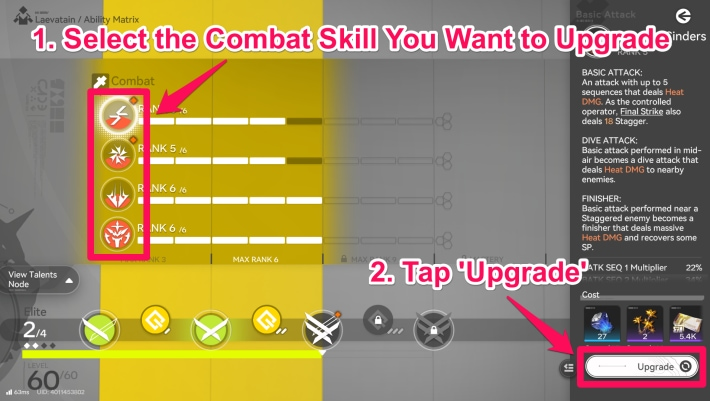
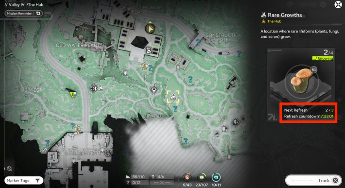

# DCL-C07：材料缺口与获取路径的连续语境

研究日期：2026-11-11。状态 **partial**。已完成两张作者攻略图与官方改动规则的研究；“缺料 → 详情 → 自选箱预选 → 返回需求”的关键操作链未实录，不能计为完整交互研究。

## 情境、来源与边界

目标：为一项能力升级补齐材料，始终清楚要补哪种、补多少、为什么补。官方[2026/04/13开发组通讯](https://endfield.gryphline.com/zh-tw/news/4494)说明材料不足时可进入相应自选箱并预选材料及数量，另提供获取入口。这是官方功能声明，非实测。

另读 GameWith 的[能力升级步骤](https://gamewith.net/akendfield/72708)与[日常材料说明](https://gamewith.net/akendfield/72426)，取得两张由攻略作者批注的图。它们只能补充需求端和来源端的外观，不是同一个人物、材料或时间上的前后帧。来源、版本未知项、原图哈希见 [sources.json](sources.json)。

## Key Screens / 关键画面

KS07-01：左侧能力与等级结构、中部黄色角色身份区域、右侧能力说明和成本、右下升级入口。大号粉红箭头和英文操作说明是 **GameWith 作者批注**，不属于游戏 UI，也不是本项目添加的用户标记。小成本图标与文本组成独立成本区。不能确认该图是材料不足状态。

KS07-02：地图中的选中资源与右侧详情相邻，详情带资源图像、当前数量和刷新信息，底部有追踪入口。红框是攻略作者强调，不是游戏自身警告。原作者正文提及从库存的获取信息查看材料位置；该图不能单独证明从升级面板进入过这里。

## Experience Notes / 体验观察

- 需求端将能力效果和成本放在同一详情区域，便于解释为什么需要材料；来源端提供对象形象、空间位置和时间约束。它们可构成研究上的两端，却尚缺把两端串起来的行为证据。
- 工业黄在需求端较大面积使用，来源端则以较小的目标强调落在地图上。**风格一致不意味着每个页面应有相同的黄色面积**；视觉份额应服从当前任务。
- 作者批注大幅改变了视觉重心。本研究不根据粉色箭头判断游戏原有按钮的可发现性，不把教程引导成功当自然使用成功。
- 官方自动预选规则提示一个重要问题：预填减少输入，也可能隐藏选择理由。需要显示自动选择的材料、缺口与数量，并允许纠正；是否真的易理解仍未验证。

## Motion Specification / 动效说明

尚无原始连续媒体。无法确定跨页动画、自动预选到可编辑之间的时机、返回时焦点，以及任务是否因开箱自动刷新。所有毫秒值、缓动与输入响应留未知。两张作者图不是动画关键帧。

## Interaction Flow / 交互流程

| 工作链 | 支持与缺口 |
| --- | --- |
| 选择能力 → 查看效果与成本 → 升级入口 | 作者步骤与静态图支持；未观察按下后结果 |
| 材料不足 → 材料详情 → 自选箱预选 | 官方描述支持规则；具体关键状态画面缺失 |
| 库存获取信息 → 地图资源位置／追踪 | 作者文字说明与来源端截图，非连续实录 |
| 补齐后返回能力／原缺口刷新 | 未观察；不得默认自动返回或保留选择 |

## 候选机制与总控台映射

**C07-P01：跳转携带“所需对象＋缺口＋原目标”。** 总控台的前置对象详情可固定保留 `为任务A查看B；A仍缺B、C`，让当前查看对象与原工作目标同时可见。选择另一个前置时更新当前对象，原目标仍保留。应以路径/标题表达，不能让返回目标依赖短暂动画记忆。

**C07-P02：预填是建议而不是无声决策。** 若打开依赖对象时自动选中了某个证据或来源，显示选择依据及其他可选来源；只有用户明确执行才改变任务状态。缺口信息不应在跨页时变成泛用全文搜索。

文字草图：`A／缺材料证据B → B详情[用于A、缺1份] → 来源选项[当前选择与原因] → 查看原件 → 返回A`。这里的材料比喻只迁移到证据缺口，不能把人的任务完成当消耗品开箱；不自动扣减、自动完成或建立不真实数量模型。

反例与检验：多个任务共享同一前置时，固定一条原目标路径可能误导；需要显示当前进入路径且允许查看其他引用。比较带原目标栏与裸详情两方案，检查是否能找回起点及准确说明仍有哪些阻塞。未进行真人测试。

补采：带缺料状态的同版本升级过程、自选箱入口及可纠正预选、补充后的刷新和返回。当前保留部分研究状态，来源声明与真实过程不能混记。

## 2026-11-11 补采复核

进一步检查了官方7017、4494原HTML的媒体地址，相关前置任务／材料自选箱段落没有找到对应过程媒体；没有把相邻但无关的GIF当作证据。原始HTTP访问endfield.games的系统／工业教程遇到TLS连接失败，未关闭验证或绕过登录。公开索引检索仍主要返回功能声明和广泛攻略。具体路由与结果已登记在sources.json的supplemental_search。本例维持partial，不降低原验收标准；取得同版本真实操作材料后再更新。
