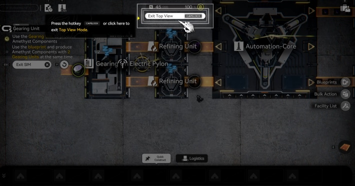
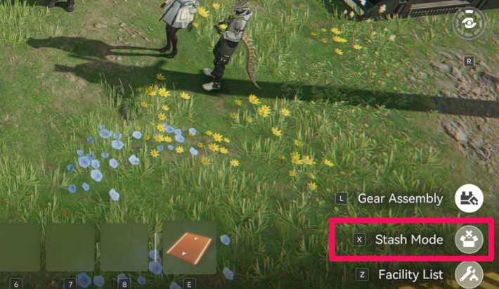
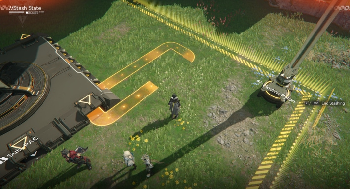
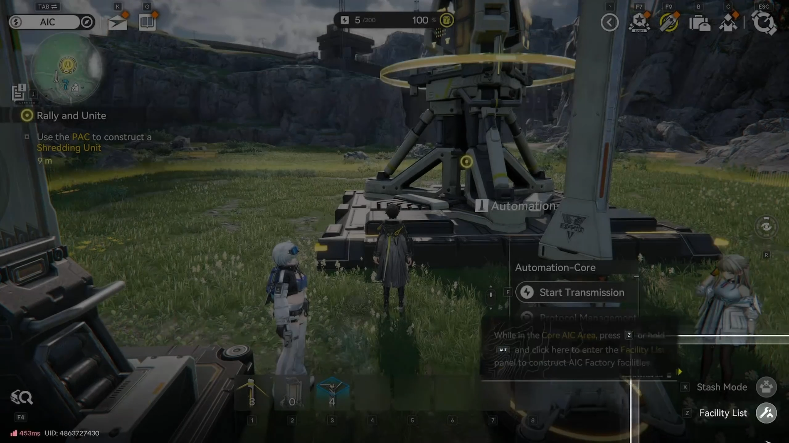
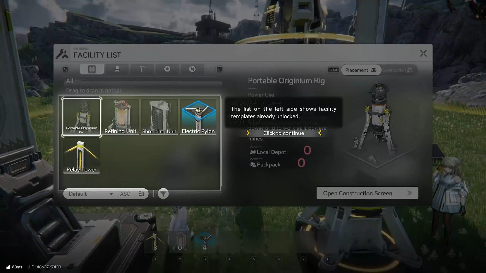
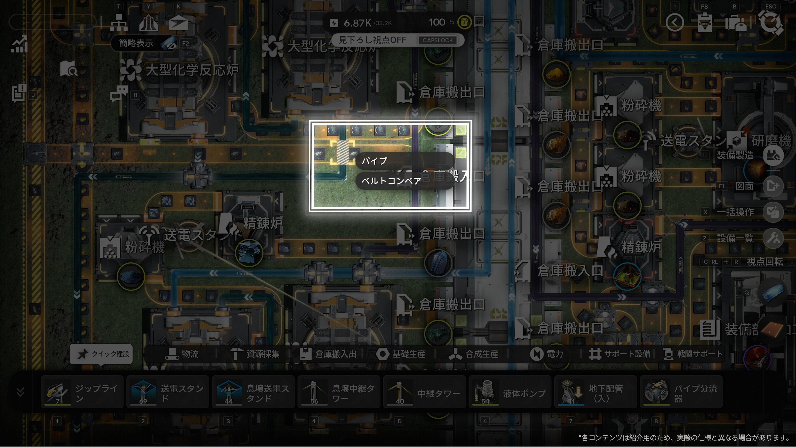

# DCL-C10：俯瞰模式、对象消歧与安全退出

研究日期：2026-11-11。状态：**partial**。已有俯瞰及收回模式截图、官方改动说明，并核查一段设施列表教学短视频的五个解码采样帧。另取得官方开发预览的真实消歧列表画面；选择后的详情与退出后上下文仍缺连续记录。

## 来源与研究范围

- C10-S01：[GameWith AIC指南](https://gamewith.net/akendfield/72372)，作者图文／短视频，分别定位俯瞰、设施选择、收回与连接保留段落。素材未证明同一次连续操作；精确build未知。
- C10-S02：[官方向渊行更新说明](https://endfield.gryphline.com/zh-tw/news/5200)，2026/07/16，说明俯瞰中重叠设施可用选项列表消歧。是功能声明，不是本例已观察行为。
- C10-S03：[官方新潮起通讯](https://endfield.gryphline.com/zh-tw/news/2662)，说明PC退出俯瞰的配置改动；本例不据此断言每个版本按ESC都同样处理。

- C10-S04：[官方日文向淵行开发通信](https://endfield.gryphline.com/ja-jp/news/7017)，2026/07/11，提供重叠对象候选菜单的静态开发预览；底部注明介绍内容与实际规格可能不同，不能当正式版本逐帧实录。

任务是“俯瞰→选择重叠对象→详情→取消／退出”。实际取证只覆盖其中部分。原件和哈希见[sources.json](sources.json)。

## 1. Key Screens



KS01可见较大面积的俯视布局，多个设施名称叠在空间对象上，顶部显式Exit Top View控件。画面还有引导高亮及教学说明，代表教学场景，不能直接当熟练玩家常态界面。



KS02红色框由攻略作者加入。游戏控件本身有图标、文字与键位提示，避免仅用图标区分操作。



KS03左上标明Stash State，右侧显示结束操作提示。线路有橙黄色可视反馈，背景场景仍保留。该图不证明拆除已经发生；来源文字说明连接设施可能保留但停运，这也说明“对象消失”不能等同整个关系一起消失。

另存[设施选择短视频](evidence/facility-select.mp4)，来源为S01中“Select a Facility from the Facility List”。原片2.933333秒、2560×1440，已核查[第二次解码记录](evidence/frames-v2/capture.json)对应的五个采样帧；时间仅属于发布片段，不是原始输入计时。





五帧显示：0.000秒为场景中的教学说明；0.587秒在右下出现入口教学和局部高亮；1.173秒场景保留而多数HUD未显示；1.760与2.347秒显示设施列表，左侧对象集合及右侧当前对象／库存信息可见。可以确认这段发布片段由场景引导进入列表，不能确认按键、鼠标按下的原始时点或完整选择结果。它是教学情境，不是重叠对象消歧列表。

首次抽帧产生五张完全相同的图，保留在 evidence/frames/ 作为失败证据，不用于推导时序。修复媒体Range读取和解码后输出到独立的frames-v2，原失败文件未覆盖；来源清单分别登记两组哈希。



KS06为3840×2160单帧PNG，已检查并非APNG/GIF。中央同一位置出现上下两条候选“パイプ”（管道）与“ベルトコンベア”（传送带），每项使用文字，背景的俯瞰场景与大量设施名称保留。中央白色矩形、外部压暗属于此官方介绍图的强调表达，不能据此认定游戏实时会施加相同遮罩。顶部可见“見下ろし視点OFF / CAPSLOCK”，但没有拍到退出动作。该图让“存在何种选择列表”的证据从声明推进到实际画面，仍未覆盖点击某项之后的结果。

补查公开教程页 `https://endfield.games/zh-Hans/tutorials/factory/` 两次HTTPS均以SSL unexpected EOF失败，未取得内容，未登录或绕过。未继续扩大搜索。

## 2. Experience Notes

Agent观察与假设：

- 大视野有助于同时显示结构，但名称叠置可能使点击目标含糊。官方KS06已显示把重叠位置展开成两条可读候选的表达；它把模糊空间目标转成明确对象名称。但仍需核查选择结果、重复点击、对象很多时的溢出，不应预设它解决了全部遮挡。
- 模式名称与结束动作是与图形高亮并行的语义线索。单纯把背景变暗无法解释当前能做什么、如何离开。
- 对象操作和关系存续应分开说明。任务移出当前视图、隐藏或完成，都不能默默等同解除依赖。
- KS04/05的教学遮罩把注意力从入口引到左侧对象集合，后者与右侧对象内容分工。候选机制是让每次焦点转换都有明确对象，而不是所有面板同时入场。反例：频繁使用的工作台不应反复强制播放教学遮罩；该机制的常态表达可以是轻量选中与路径提示。

## 3. Motion Specification

已观察到上述发布片段由场景教学进入设施列表的次序；采样点只能限定变化发生在两个采样之间，不能精确测量过渡持续时间。未测俯瞰进入／退出镜头、重叠消歧列表的打开／选择过渡、快速取消、键盘焦点恢复或重复输入。视频与其他静态图不得跨版本拼接；没有可靠的原始输入时点、缓动和延迟，也没有人类体验记录。

## 4. Interaction Flow

| 过程 | 当前材料 | 证据界限 |
| --- | --- | --- |
| S0普通场景→S1俯瞰 | KS01有俯瞰状态；S01说明模式用途 | 没有本次进入转换 |
| S1→S2选择重叠对象 | S02声明，S04/KS06直接显示管道与传送带候选列表 | 没有打开过程、原始输入或候选溢出 |
| S2→S3详情 | 尚未取得对应对象的详情过程 | 不把其他设施选择视频当重叠消歧证据 |
| S3→S1取消／退出 | KS01显示退出入口，S03说明配置 | 返回选择、视角及焦点保留未知 |

## 对总控台的迁移与多样小样建议

空间依赖图中，聚集节点应有稳定的对象列表入口；选择与执行分开，提供可见的返回原任务路径。模式切换至少交代当前任务、查看范围和退出方式。

```text
当前位置：任务A的依赖图
此处有3个对象：[任务B] [任务C] [资料D]
选择对象只查看，不自动改变依赖
返回任务A／退出关系视图
```

反例：对少量依赖而言，一张有清楚方向的列表可能比空间图更可靠。不能因为游戏适合俯瞰就强制总控台采用大画布。小样应真正比较“空间图＋消歧列表”“逐层路径”“纯对象列表”，以恢复上下文和判断阻塞方向为标准；三版只改背景材质没有研究意义。

本轮已观察模式提示、对象与关系区别及消歧候选菜单的实际表达；消歧的选择结果与退出恢复仍待验证。主要操作链尚缺，不能计完整交互案例完成。回到[项目入口](../../README.md)。
