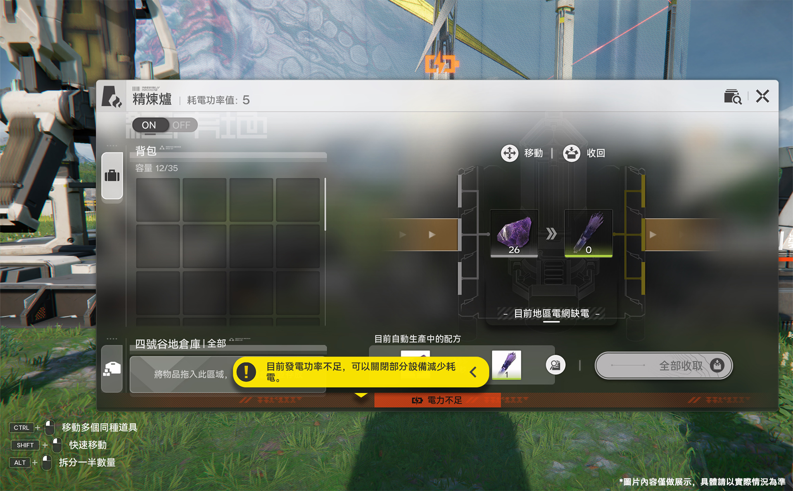
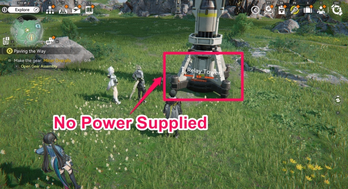
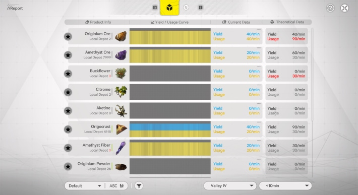

# DCL-C08：产线异常如何变成可行动的诊断

研究日期：2026-11-11。状态：**partial，已完成有边界的资料分析，尚未完成既定交互案例验收**。没有游戏实操或人类可用性测试。

## 情境、来源与版本

目标：发现某设施停产后，理解原因并找到下一步，而不是只看到一个警报。

- C08-S01：[官方全面测试通讯](https://endfield.gryphline.com/zh-tw/news/1340)，2025/11/01；“配方详情页提示”。角色是官方功能声明及静态预览，不是2026当前客户端实测。
- C08-S02：[GameWith设施故障指南](https://gamewith.net/akendfield/72376)，页面标示2026/01/25。角色是攻略作者的截图和诊断说明。精确build、输入设备、截图采集日期未知。
- 本文图片按来源分别观察，未拼成同一次停产的前后过程。原件与SHA256见[sources.json](sources.json)。

## 1. Key Screens



KS01／E01可见：顶部先交代设备身份与功率；右侧以输入→输出关系描述配方；异常同时具有底部橙色状态带、生产关系附近的文字及黄色建议浮层。黄色浮层包含原因和减少耗电的建议，信息不止“有错误”。它是画面中的原始提示，不是Agent新增批注。



KS02／E02中红框、箭头和大字是GameWith作者批注，不能归为游戏自身UI。原场景里仍能看到设施名称与未供电状态，告警与空间对象绑定。



KS03／E04呈现产量与消耗、当前与理论数据的列式比较。来源图片标题提及PAC，但实际画面是Report；本例按实际画面记录为报表，不把网页图注当作可靠界面名称。另存的[E03](evidence/idle-state.png)是设施闲置图，不能假定与KS01属于同一故障。

## 2. Experience Notes

以下为Agent视觉分析，不是玩家原话：

| 证据 | 机制假设 | 条件与代价 |
| --- | --- | --- |
| KS01身份、配方关系、警报共处一面板 | 在发生问题的对象上下文中解释原因，减少从全局红点猜测对象的负担 | 同时出现多处告警可能重复、遮挡；截图不能证明哪一处先被注意 |
| KS01橙色状态与黄色建议承担不同角色 | “状态是什么”和“可以做什么”应有不同信息层级 | 色彩本身不能独立承担含义；需要文本和可发现动作，不能将所有元素都设为高亮 |
| KS02具名对象，KS03比较当前与理论 | 局部故障与系统性供需失衡应分开诊断 | 一项任务受阻可能有多个原因，不能把一个局部提示当作唯一根因 |

作者指南区分供电、容量、搬运拥堵等问题，并建议检查设施或全局供需。这里借鉴“分类诊断”的思路；未复现其每个修复方案，也不据此判断游戏所有告警都准确。

## 3. Motion Specification

未获得“发现→打开提示→定位→恢复”的连续材料。警报出现时间、浮层打开动作、持续时间、缓动、焦点迁移与输入接管均未知。静态浮层存在不等于它自动出现或可点击；这些字段没有填写推测值。

## 4. Interaction Flow

| 阶段 | 证据覆盖 | 目前不能声称 |
| --- | --- | --- |
| S0设施有异常 | KS02作者截图显示未供电对象 | 是同一设施后续被修好 |
| S1打开设备／配方详情 | KS01官方图展示原因与建议；来源说明功能意图 | S0→S1的实际触发与耗时已观察 |
| S2找到局部／系统原因 | 攻略说明分类诊断；KS03展示报表可表达供需 | 从配方面板直接跳到这张报表 |
| S3执行建议并检查恢复 | 缺实际前后记录 | 告警清除、产量恢复或用户成功率 |

## 对总控台的迁移

候选结构：`任务身份 → 阻塞状态 → 具体前置对象／资源差额 → 原因证据 → 可进入的处理入口`。保留“查看前置”和“返回原任务”，不要用“解决”按钮在没有真实状态变更时制造成功。

局部文字映射：

```text
确定竞赛主选方向  [受阻：2项前置未完成]
├─ 校内手续确认     未完成 → 查看依据／打开任务
└─ 最小技术验证     未完成 → 查看实验／打开任务
返回原任务 · 保留原筛选
```

反例：前置任务已完成也可能缺验收材料；单纯按状态推导“已解除阻塞”会误报。全局依赖告警还应区别直接前置、传递前置和资源不足。不能迁移游戏功率数值、设备图像或将所有阻塞原因画成单条生产链。

下一步明确缺口：取得一个同版本故障发现、打开原因、处理、恢复的连续记录。当前不计入“完整交互案例完成”数量。回到[项目入口](../../README.md)。
