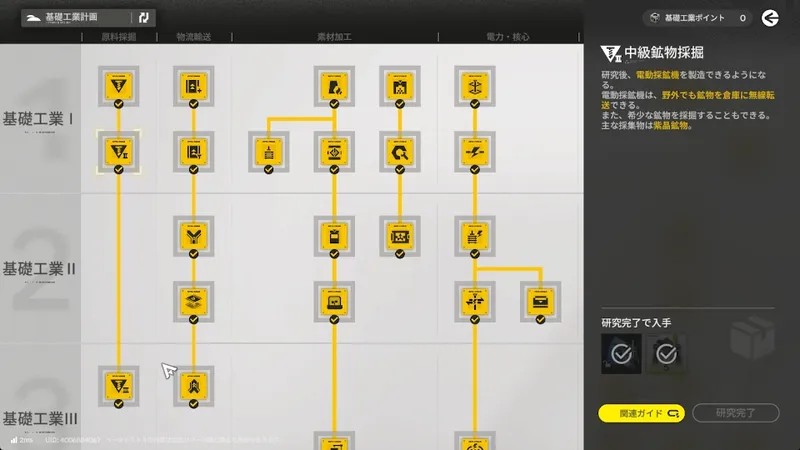
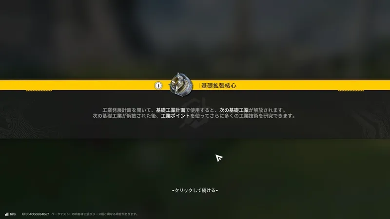

# DCL-C06：工业技术的前置任务与跳转

研究日期：2026-11-11。状态 **partial**。已完成官方交互规则与两张技术规划画面的资料分析；没有取得“未解锁节点 → 点击前置任务 → 回看原节点”的连续实录，不能计为完整交互案例。

## 来源与情境

用户想研究一项技术，但前置任务尚未完成。官方[日文开发通信](https://endfield.gryphline.com/ja-jp/news/7017)2026/07/11“工業計画の表示を改善”说明：条件旁提供任务入口；已接取时进入任务界面，未接取时提供提示。此为官方规则声明，不是 Agent 实测。较早的[AppMedia 原作者攻略](https://appmedia.jp/Arknights_Endfield/79451402)提供技术树和阶段解锁截图；图片带测试信息，页面更新时间不能当作截图 build。见 [sources.json](sources.json)。

## Key Screens / 关键画面

KS06-01：技术树按横向类别和纵向基础工业阶段组织；黄色节点及连接线构成主要关系层；右侧深色详情栏与浅色图分隔。右下出现相关引导与已完成外观的动作区。屏幕中许多节点带勾，不可据此认定是未解锁条件画面。

KS06-02：阶段解锁说明使用横向黄色条、居中对象图像、短文本与底部继续提示，背景弱化。该图不与KS06-01组成同一次操作；它说明的是阶段获得反馈的视觉样本。

## Experience Notes / 体验观察

- 直接观察：图与详情分区，类别与阶段是两套坐标，节点间线条另表关系。**相同黄色同时出现在大量已完成节点和动作按钮，不能简单迁移为“黄色就是当前选择”**。
- 作者攻略描述点数获取与研究阶段，但未提供当前前置任务跳转的录屏。初版技术树与后来的官方规则分开登记，不拼成操作实测。
- Agent 机制假设：把原因旁的前置对象做成入口，比在别处另列一份“待办”更能维持语境；这是信息邻近性的推导，尚无任务耗时证明。
- 代价：复杂树的黄色连线过多会降低突出一条阻塞链的能力。依赖导航应区分关系方向、完成状态和当前选择；不能让所有边同等强调。

## Motion Specification / 动效说明

只有静态图片和官方规则，没有转换时长、缩放轨迹、跳转时焦点及返回恢复的观测。阶段提示的背景弱化可见，出现／退出方式未知；不把截图估成动效参数。

## Interaction Flow / 交互流程

| 状态与转换 | 证据状态 |
| --- | --- |
| 选择技术 → 右侧详情 | 静态图见结果；选择输入未记录 |
| 发现前置任务条件 → 点击旁边入口 | 官方规则声明；相关未解锁画面缺失 |
| 已接取任务 → 进入任务界面 | 官方声明的条件分支，未实录 |
| 未接取任务 → 提示 | 官方声明的另一分支，未实录 |
| 返回原技术并保留位置 | 无证据；不能默认实现 |

## 研究判断与迁移

**C06-P01：原因、对象和行动入口相邻，分支条件明确。** 总控台可呈现：`任务A不能开始 → 前置B尚未完成 → 查看B`；若B缺失或无访问路径，应显示具体不可用原因，不静默跳到总列表。

**C06-P02：依赖关系与执行状态使用不同的表达通道。** 树状线说明方向；状态用标签/图标；焦点用局部描边，不复制满树亮黄。文字草图：`原任务A／未完成前置2项 → 选B → B详情＋路径 A←B → 返回A`。

反例：任务关系可能多对多，严格阶段树会隐藏共享前置；项目分类也不是任务前置。原产品阶段解锁的视觉庆祝不适合每次工作项状态变化，暂不迁移。

验证设计：同一组一对多、多对多、前置已完成、前置缺失样例，比较原因列表与关系图两种结构；让检查者指出阻塞方向及未满足条件。结果尚无。

补采仍需：相同版本的锁定节点、任务入口触发、两种条件分支及返回位置证据。已分析记录不能填作全流程验证完成。

## 2026-11-11 补采复核

进一步检查了官方7017、4494原HTML的媒体地址，相关前置任务／材料自选箱段落没有找到对应过程媒体；没有把相邻但无关的GIF当作证据。原始HTTP访问endfield.games的系统／工业教程遇到TLS连接失败，未关闭验证或绕过登录。公开索引检索仍主要返回功能声明和广泛攻略。具体路由与结果已登记在sources.json的supplemental_search。本例维持partial，不降低原验收标准；取得同版本真实操作材料后再更新。
