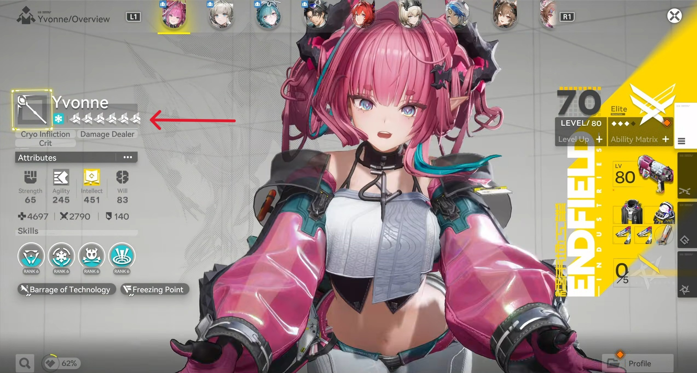
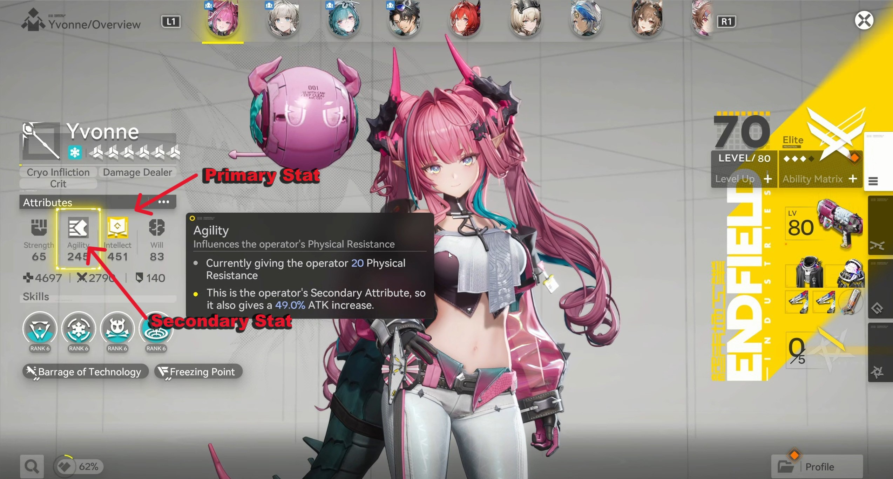

# DCL-C03：干员身份、属性与视觉重心

研究日期：2026-11-11。**资料研究报告已完成；原计划“展示／档案切换并返回列表”仍为 partial。** 本次实际范围是同一干员总览的两张作者批注画面：身份与属性解释层级；没有观察 Profile 的打开、档案内部或返回列表。

## 来源和条件

S01：[Into Indie Games 的作者入门指南](https://intoindiegames.com/walkthroughs/tips-tricks/how-to-play-arknights-endfield/)，Mahmud Munazil Rahman，页面显示 2026-01-21。定位 Understanding Operators 和 Primary & Secondary Stats。两图同为 Yvonne 总览，带来源作者红色箭头及文字。画面显示 L1/R1 输入提示，但实际平台、客户端 build、截图是否连续未知；不把发表日当作录制日。

S02：[u/JustUseDex 的角色查看困惑原帖](https://www.reddit.com/r/ArknightsEndfield/comments/1qo5h40/how_to_view_characters/)。S03：[拥有与未拥有干员图鉴讨论](https://www.reddit.com/r/Endfield/comments/1qnl4zy/how_do_we_access_the_operator_gallery_or_can_we/)。两帖仅有相对日期，精确版本未核查，作为用户自述而非当前缺陷证明。

## Key Screens

| ID | 实际视觉观察 | 解释边界 |
| --- | --- | --- |
| OBS01 | 中央人物占据最大面积；左侧姓名、身份标签、属性与技能纵向分组；右侧黄底把等级和装备聚成一条功能带 | 美术主体与业务信息分布清楚，但这是收藏／养成情境，不能推出任务管理也应给插图大面积 |
| OBS02 | 顶部横向头像保留其他对象；当前头像有黄色背景及下划线，左上显示对象名／Overview | 对象切换入口与当前对象身份同时存在；未观察切换动画和顺序，不能宣称切换时位置稳定 |
| OBS03 | KS02 中敏捷有描边焦点，而智力仍保持黄色填色；暗色说明浮层覆盖部分人物，数字布局仍在左侧 | **焦点与固有主属性不是同一状态**。与原图对照可见两套视觉语义；浮层触发是悬停、点击还是手柄选择未知 |
| OBS04 | 几何网格、竖向品牌字和黄白分区形成工业气质；关键数字相对装饰有自己的分组与对齐 | 可借鉴视觉职责的分工，不复制品牌字、人物资源、具体字号或未测颜色 token |

## Experience Notes 与反证

用户 u/JustUseDex 的原话摘录：

> “I’m currently stuck in gacha game menu hell trying to navigate.”

该用户想看全部角色而非仅已拥有角色。另一帖有用户给出从菜单进入已拥有干员详情的路径，但发帖者继续追问未拥有角色。这里的冲突主要是**入口的对象范围与用户目标不同**，不能简化为“角色画面漂亮所以导航成功”，也不能断言游戏永远没有全部角色入口。

Agent 解释：身份表达需要同时回答“当前是谁”和“当前集合包含谁”。候选原则 P03-A 是在对象详情旁保持集合范围可见；P03-B 是用独立语义区分对象固有属性、当前焦点和可执行操作。反例是把每种语义都赋予强烈色彩，会产生竞争与认知负担。

## Motion Specification

两张图存在人物姿态与属性浮层差异，不能推算经过时间、触发方式、缓动或动画路径。总览的实际动效和 Profile 导航未观看；报告不编造时长。没有本轮真人操作实验。

## Interaction Flow

`拥有干员集合 → 当前干员总览 → 属性解释`：前两者在画面上并存，属性解释终点在 KS02 可见；触发顺序由版面关系提出，非连续录制。`Profile → 档案 → 返回列表` 仍缺。两个 Reddit 讨论提供导航自述和目标差异，不替代输入录像。

## 对总控台的迁移

候选局部结构：`项目身份＋集合范围（当前项目／全部）` 固定在上方；`任务目标／状态` 为主要文本；`属性解释` 按需展开；`前置对象` 保持可发现。选中任务可以使用轮廓强调，阻塞状态仍用文字与独立符号表达。

不迁移中央大人物和右侧大黄带的面积比例。项目管理以任务判断为主，应让阻塞原因而非装饰图像成为重心。检验样例应包含筛选后为空、跨项目前置、当前对象被过滤掉三种情境；检查用户能否说出自己正在看哪一集合、哪一任务，以及为什么出现该解释。

资料报告已复核；完整档案链和返回验证待补。原图、来源、哈希和状态见 [sources.json](sources.json)。回到[项目入口](../../README.md)。
