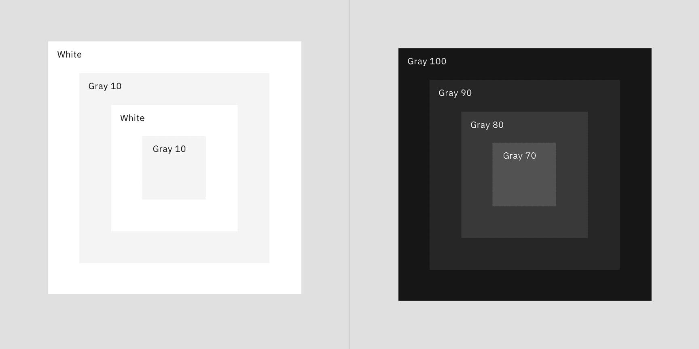
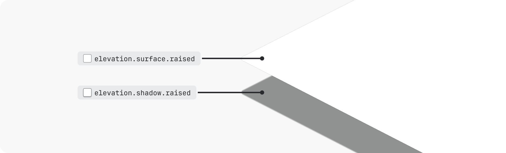
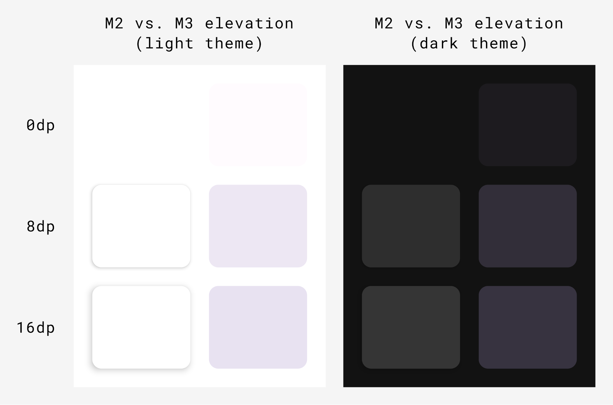

# V01：克制的界面如何形成层次

2026-11-11 · 三套独立设计体系的官方规则和示意图对照；不是三次完整产品使用研究。[来源与哈希](sources.json)。用户指出旧六版单调，本例针对表面、主次与视觉节奏研究。

## Key Screens

V01-S01：Carbon 图中浅色层交替，深色层逐级变亮；色彩角色跨主题保持，实际值可变。其高对比区用于大区语境转换。这里的嵌套方块是官方解释图，不是目标产品必须照搬的四层卡片。

V01-S02：图把承载面和投影分开标示。官方规定 raised/overlay 的用途，同时指出不必用抬升替代足够有效的留白或边线。这与“所有层都铺阴影”不同，也反驳“所有阴影都应禁用”的泛化。

V01-S03：图中传统投影与带色调的面形成两种区分方式，深色示例也变化；支持把表面色、投影和文字强调分开选择，不意味着本项目应继承其圆角或紫色。

## Experience Notes

共同点是让层次承担分区、焦点或覆盖关系；差异在于采用何种明暗逻辑、投影和颜色。旧六版把同质浅面＋细线复用到多数内容区，结构变化没有同时检验美术表达。由此提出原创假设：在内容不变时，区分背景、工作区、当前对象和局部原因；用真实关系图形与文字尺度形成节奏，材质留在阅读区外。

反例：核对清单可以主要依靠标题、行距和分隔线；小型工具未必需要三层容器。任务列表每行都抬升，会竞争焦点；纯装饰图形若看起来像进度或关系，会误导判断。主题规则不能机械反色，状态也不能只靠颜色。

## Motion Specification

静态图没有提供响应时长。新实验只使用短的对象切换反馈，具体时长属于原创选择；减少动态效果时关闭。不能将示意投影推断为拖动、层叠动画或游戏动效。

## Interaction Flow

这里研究的是“进入工作区→辨认当前对象→查看具体原因→返回”的视觉职责，不是原产品操作链。背景负责定位，内容面负责阅读，焦点层负责当前对象，暂时浮层才负责覆盖。每一显著表面变化须说明对应职责；没有需要时允许平面布局。

## 本轮可执行映射

- **G 工作台**：冷色环境、暗色任务导航、突出当前对象，原因与直接前置放在主工作面；用数据生成的满足比例图辅助定位。
- **H 研判页**：暖色纸面、摘要边栏和原因清单，依靠字体、留白与正文节奏区分主次；不复制游戏 HUD。
- 二者保留相同的关系事实与返回要求。去纹理对照只用于辨认材质贡献，不当作审美分数或人类测试。

可读性依据 V01-S04/05：普通文字对比度最低4.5:1，大字最低3:1；目标尺寸最低24 CSS px有例外。本地实验额外以主要触控按钮44px作为项目目标，不将此值冒称WCAG2.5.8要求。只测选定配色与控件不等于完整无障碍合规。
