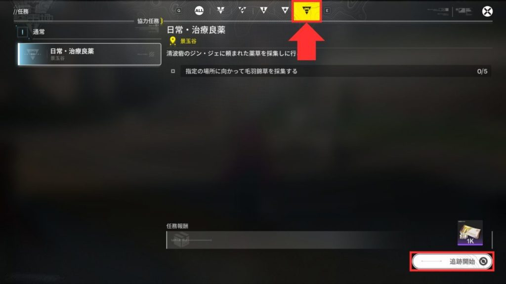

# DCL-C02：任务选择与追踪入口

研究日期：2026-11-11。**资料研究报告已完成；原计划操作链仅部分覆盖（partial）**。未完成“进入目的地／信息后再回看原任务”的直接观察，不计为完整交互验证。

原计划为“找到任务→启动追踪→进入目的地或信息→回看任务”。本次实际可审阅范围收束为**任务类别、当前对象、进度与追踪入口怎样被组织**。环境是作者公开的日文界面，截图精确客户端版本、输入设备、体验者熟悉程度未知；发表日期不是游戏版本证明。

## 证据与定位

S01：[Shibu-lab 日常任务图文](https://shibu-lab.com/en/5464/)，页面显示 2026-03-03，定位“Where do you receive your contractual assignments from?”。作者给出菜单→任务→右侧类别→开始追踪的操作说明，并提供一张带作者红色批注的任务界面。其任务耗时推荐不在本研究内采信。

本图是来源页面的原始文件，**已含来源作者的红箭头和红框**，并非没有批注的游戏原帧。批注不冒充玩家自然注意轨迹；登记与哈希见 [sources.json](sources.json)。

## Key Screens：可观察结构

| ID | 实际观察 | 作用解释与边界 |
| --- | --- | --- |
| OBS01 | 左侧窄列表有一个带明亮边框的任务行；右侧显示较大任务标题、地点和说明 | 候选机制是把“选择对象”与“理解对象”放在相邻区域；一张图不能证明跨类别筛选保留选择 |
| OBS02 | 顶部一排任务类别符号；当前一项为高明度黄色矩形背景 | 类别与任务行是两个不同层级的选择；作者大红箭头额外增强了可发现性，不能据此判断原界面的识别速度 |
| OBS03 | 目标行右侧有 0/5；奖励与追踪按钮分置底部，追踪入口靠右 | 过程进度、收益与下一步动作有空间分工；不能只因按钮显眼就推出玩家理解追踪的后果 |
| OBS04 | 内容区大量深色留白，分隔线和行背景较淡，标题及当前选择更亮 | 克制纹理让任务文本成为工作中心；只有一个任务时的留白无法证明长列表仍易读 |

## Experience Notes：事实、解释与反例

没有本轮真实玩家访谈或操作计时。以下均为 Agent 解释：

- **候选原则 P02-A：当前对象与动作同屏。** 对总控台可把原任务列表留在左侧，阻塞原因和“查看前置”放在相邻详情；代价是小屏可用宽度下降，需要窄屏单列和明确返回。
- **P02-B：类别选择不等于执行状态。** 黄底类别与白框任务行承担不同语义。总控台应分别表达筛选范围、当前选中、阻塞状态；同色承载三者可能令用户误把选中当作阻塞。
- **反例条件：** 类别只用抽象图标，对不熟悉图例的用户可能增加记忆负担。迁移时保留中文标签，不复制游戏符号。

## Motion Specification

仅静态图文，选中高亮、详情出现、追踪后跳转的持续时间和缓动均未知。没有把红色教学箭头当作游戏动效。后续需同版本连续操作，才能讨论焦点转移和返回状态。

## Interaction Flow

| 转换 | 支持等级 | 当前结论 |
| --- | --- | --- |
| 菜单→任务类别 | 作者步骤声明 | 有明确的步骤说明，未直接看到输入发生 |
| 类别→任务详情 | 终点画面可见 | KS01 同时显示类别、任务行、详情和按钮，具体触发未知 |
| 开始追踪→地图提示 | 作者步骤声明 | 作者说明会显示在地图；没有相应地图终点图，不升级为已观察 |
| 地图／信息→原任务 | 未覆盖 | 返回位置、筛选和选择是否保留均未知 |

## 迁移小样与检查

文字映射：`任务列表（保留筛选）｜所选任务：阻塞原因 → 前置对象 → 查看前置`。区别于把“阻塞 3 项”放在首页角落而不说明对象。先用两个并行前置、一长一短标题检验当前对象与类别是否混淆；不沿用奖励区、游戏任务图标或日常打卡逻辑。

资料分析与边界复核完成；还需要一段任务追踪并返回的真实过程材料。检验记录：原图已检查，文件大小与 SHA256 已登记；没有用户测试、游戏运行或正式版复现。回到[项目入口](../../README.md)。
