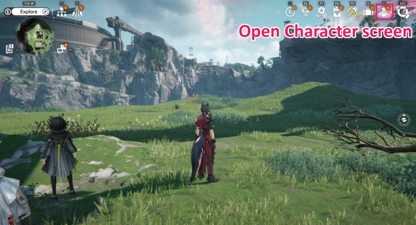
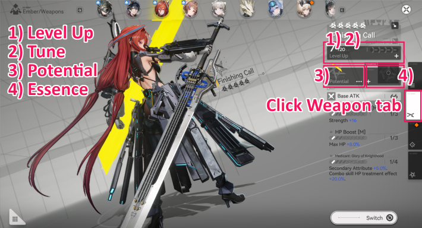
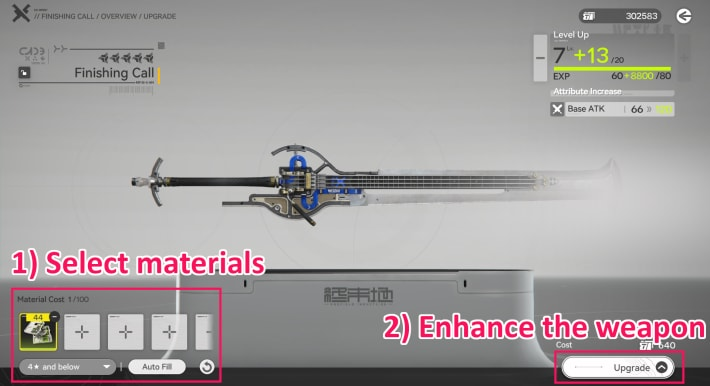

# DCL-C04：武器详情与数值变化预览

研究日期：2026-11-11。**资料研究报告已完成；原题的两武器比较／返回链仅部分覆盖（partial）。** 为避免编造，本次实际范围收束为“从场景入口进入武器详情，再选择强化材料查看预期变化”。它揭示高密度信息的分区与差异预览，不宣称已观察两对象对比功能。

## 来源和观察条件

S01：[GameWith Weapon Enhancement Guide](https://gamewith.net/akendfield/72716)，Arknights: Endfield Strategy Team，页面显示 Last Updated February 25, 2026 9:59 PM。定位 How to Enhance Weapons 中的三个有序步骤。图片是来源原始文件，但**原本就带粉色框与文字等作者批注**，不是 Agent 批注，也不是未经处理的客户端原帧。

S02：[PowerPyx Rally and Unite](https://www.powerpyx.com/arknights-endfield-rally-and-unite-walkthrough/)，2026-01-21，定位 Equipping & Leveling Weapons。作者给出武器页→Switch→换武器的步骤，只作为另一份作者操作说明；未把不同作者、不同对象截图拼成同一次过程。

## Key Screens

| ID | 实际观察 | 机制假设及限制 |
| --- | --- | --- |
| OBS01 | KS01 入口位于场景顶边的一组图标；作者用大文字标注并框选 | 图文能定位入口，不证明不带批注时容易发现，也不能测寻路耗时 |
| OBS02 | KS02 右侧有基础攻击、属性、技能说明与多个强化入口；中央显示角色与武器，顶部仍有对象头像 | 对象身份、功能分区、参数组和说明层次共存；不同功能并非一条线性进度，迁移时不能将所有步骤排成装饰编号 |
| OBS03 | KS03 保留武器名称和大幅武器形象；左下有材料槽及 Auto Fill，右下有 Upgrade；右上用不同色数值显示等级／攻击的预期增加 | 这是同一对象变化前后的**数值预览**；不等于观察两把武器的差值比较，更不是完成后的结果截图 |
| OBS04 | 粉色大字覆盖部分原信息，强化效果的细节可读范围有限 | 不能据作者教学覆盖层推断原界面字体、留白和全部可点区域；这类素材适合找结构，不适合精确测量视觉 token |

## Experience Notes、条件与反例

当前没有真人眼动、完成时间和误操作率。Agent 的两条候选判断：

- **P04-A：决策前把变化放到对应属性附近。** 对总控台，检查前置完成将解除哪一项阻塞时，应在原任务与前置对象旁解释影响，而非只显示一个“已完成”通知。代价是“预期解除”和“实际解除”必须有明确标签，防止误把推演当事实。
- **P04-B：局部动作保持对象身份。** 即使进入材料选择，名称与物体仍在同屏；对任务面板可保留任务目标与项目归属。反例是内容过多抢占阅读宽度，小屏需要简化身份但保留返回线索。
- 与 C03 对照：亮色会同时出现在品牌分区、当前选择和变化量。不能简单总结成“黄色表示重要”；在小样中需明确每一种强调对应什么语义。

## Motion Specification

本次核查 HTML 未发现这组步骤的 video/mp4；三图是编辑后的有序教学图，不是连续输入记录。动画时长、焦点接管、重复点击、取消时材料是否保留均未知，不填写参数。

## Interaction Flow 与覆盖

| 转换 | 依据 | 覆盖 |
| --- | --- | --- |
| 场景→干员界面→武器页 | 作者步骤和 KS01/02 | 图文过程支持，但未看到真实输入及过渡 |
| 武器页→强化选项→选择材料 | 作者步骤和 KS02/03 | 主要终点可定位，不能证明同一连续录制 |
| 改变材料→预计数值变化 | KS03 的变化量和材料槽 | 同一预览状态可观察；变化更新过程未观察 |
| 确认→结果／取消→返回 | 原计划需要 | 未覆盖 |
| 武器 A→武器 B→比较→返回 | S02 声明可切换，画面对比缺失 | 原比较问题未解决，不计交互验证完成 |

## 有边界的迁移小样

文字结构：`原任务身份｜未完成前置 A/B｜当前查看 A 的结果与影响｜继续追踪 A／返回原任务`。若制作“影响预览”，应注明它是基于当前依赖数据的推演；没有实际状态变化前不能显示“已解除”。不引入角色养成、武器稀有度、消耗型奖励或 Auto Fill 的业务逻辑。

检查条件：一个前置影响多个后续任务、前置状态在查看期间变化、预览后取消、比较两个前置但不修改状态。评判重点是语义可区分和上下文保留，不是界面是否像武器页。

来源及原件哈希见 [sources.json](sources.json)。资料复核完成；两武器比较、确认结果和返回过程仍待补采。回到[项目入口](../../README.md)。
