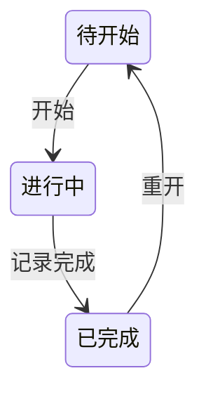

# 总控台任务状态转移

2026-11-11 · v0.2 候选设计，供逐条审阅。覆盖任务承诺、开始、登记与解除人工阻塞、完成、重开，以及有业务后果的提交和撤销。现有 [浏览器小样](index.html) 对应 v0.1，使用合成数据和内存快照。

## 现有产品约束

产品任务保存 `kind`、`status`、`deps`、`output`。Web 与 Agent 写入都按工作区 revision 进行条件更新。共享数据校验检查依赖存在及无环。Agent 写入还要求已完成任务有 `output` 且前置已完成，Web 的整包保存未执行后两项业务校验。`output` 可以是计划产出，迁移时应保留其原意。此段为对 DCL 原件所引用产品代码的研究摘要。

## 用到的方法

- **状态图与正交维度。** 用有限状态机表示执行阶段，把能同时成立的事实分开建模。人工阻塞与执行阶段可以同时存在。前置满足由依赖数据计算。借鉴状态图表达并行维度的方法，本提案用表和状态图表达语义。[W3C SCXML 并行状态](https://www.w3.org/TR/scxml/#parallel)
- **决策表与守卫。** 对每个事件写允许条件、结果、拒绝理由和恢复入口。同一条件组合应得到明确结果，拒绝分支也可作为测试场景。[OMG Decision Model and Notation](https://www.omg.org/dmn/) · [Stately Guards](https://stately.ai/docs/guards)
- **确认与错误恢复。** 重要变更前展示用户能核对的对象、差异和影响。可修改的输入在返回或校验失败后保留。这里将 GOV.UK 的提交前核对用在影响其他任务的操作上。[GOV.UK Check answers](https://design-system.service.gov.uk/patterns/check-answers/)
- **乐观并发与补偿变更。** 确认时用 revision 检查用户看过的版本，降低覆盖他人写入的风险。撤销写入新的补偿记录，只恢复原操作涉及且仍可安全恢复的字段。[RFC 9110 If-Match](https://www.rfc-editor.org/rfc/rfc9110.html#section-13.1.1) · [Microsoft 补偿事务模式](https://learn.microsoft.com/en-us/azure/architecture/patterns/compensating-transaction)

## 状态、条件和不变量

| 信息 | 候选定义 | 更新方式 |
| --- | --- | --- |
| 承诺程度 | 待验证想法、暂定方向、已承诺任务 | 独立的承诺操作。承诺后仍须显式开始。 |
| 执行阶段 | 待开始、进行中、已完成 | 开始、完成、重开改变阶段。 |
| 人工阻塞 | 一个当前阻塞记录，含原因与登记信息 | 登记或解除，历史保留。 |
| 前置条件 | 满足、待满足、无法判定，并列出原因 | 按当前依赖和前置任务阶段实时计算。缺失或循环属于无法判定。 |
| 查看位置 | 原任务、当前任务、真实经过的依赖路径 | 查看与返回只变更界面位置。 |
| 提交进度 | 草案、等待结果、已提交、需核对 | 独立显示保存结果、并发冲突和待确认回执。 |

- 有效工作数据中的依赖图无环、引用存在。跨项目关系遵守同样规则。
- 已完成任务的直接前置均已完成。新完成操作必须记录实际完成说明或可定位的成果，并满足该任务的前置条件。已有计划产出保留原字段。
- 人工阻塞可叠在待开始或进行中。前置条件变化时，进行中的任务仍显示进行中，动作资格随之重算。可读、可核对、可继续保存说明或草稿，记录完成须等条件重新满足。
- 对旧「阻塞中」记录，原阶段未知时显示「原阶段待确认」。解除人工阻塞时明确选择原阶段，与解除一同提交。已有完成记录可保留来源明确的历史阶段，证据缺失单独标注待补核。出现不一致的导入数据时提供定位与修复入口，在修复前阻止受影响的推进动作。

## 转移决策表

以下写操作均要求当前用户有对应权限。进入预览与正式提交时，依据当时可见数据分别核对条件。查看前置遵循访问权限和真实关系。

| 操作 | 允许条件 | 成功结果 | 拒绝或恢复 |
| --- | --- | --- | --- |
| 确认承诺 | 当前是想法或暂定方向，有权做承诺决策 | 承诺程度变为已承诺，待开始阶段保留 | 提示承诺条件。若旧记录已在执行，先核对历史状态。 |
| 开始 | 已承诺、待开始、前置有效且满足、无人工阻塞 | 进入进行中 | 显示具体未满足前置、人工原因或承诺入口。多项限制可以同时显示。 |
| 登记阻塞 | 已承诺、待开始或进行中、尚无当前人工阻塞，且填写原因 | 新增人工阻塞，原阶段及前置状态保留 | 原因为空时就地提示。已存在时显示当前记录。 |
| 解除阻塞 | 有当前人工阻塞。旧记录须补记待开始或进行中的原阶段 | 解除人工阻塞，重算前置和可用动作 | 若仍缺前置，回执显示剩余限制和查看入口。原阶段未知时保留草案并提示补记。 |
| 记录完成 | 已承诺、进行中、前置有效且满足、无人工阻塞、提交实际结果或成果位置 | 记录完成事实与依据。重算依赖方条件 | 说明缺失、依赖变化或人工阻塞时保留草案，显示对应恢复入口。依赖方后续由用户显式开始。 |
| 重开 | 已完成，无已完成的直接依赖方 | 回到待开始，既有完成记录保留为历史。受影响的未完成依赖方重算条件 | 存在已完成的依赖方时拒绝，列出受影响任务。有效数据图中，检查直接依赖方足以维持已完成任务的前置约束。 |
| 修改前置 | 引用有效、无环，并满足现有完成记录的约束 | 保存依赖关系，重算条件并显示有变化的任务 | 拒绝产生缺失、循环或破坏完成约束的变更。需要成组调整时单独审议。 |
| 查看前置与返回 | 存在可访问的真实边或已访问祖先 | 更新标题、路径和焦点 | 缺失、循环回边或不可访问时就地说明，保留返回位置。 |

重开策略选择**逐项检查和显式重开**。候选首版保持已完成记录的一致性。级联重开会改变其他任务的完成结论，需要另行定义权限、影响预览和撤销范围。

## 从决策到界面

- 标题和路径回答「我在哪个任务」。紧邻的阶段标签回答「实际做到了哪」。限制区显示人工原因、未完成前置或异常关系，下一步入口与原因相邻。文字和位置承担语义，配色用于辅助区分。
- 若 A 在进行中，前置 B 被重开，同时 A 有人工阻塞，解除 A 的人工阻塞后显示「人工阻塞已解除 · 仍等待 B」，保留「进行中」，提供「查看 B」。记录完成继续受限，说明或草稿仍可保存。
- 完成、重开或撤销涉及其他任务时，预览展示对象、拟变化和会改变资格的任务。登记阻塞等局部操作可以在就地表单里核对影响。反馈说明操作后的实际状态，包括仍然存在的限制。取消回到触发控件，失败保留有效输入。
- 提交回执与业务阶段在视觉上分区。等待服务端响应时显示正在保存。结果未知时先按操作标识查询，再决定是否重试。

## 提交与撤销

1. 草案记录操作、对象、当前值、拟修改字段、影响和读到的工作区 revision。取消草案结束本次操作，不生成业务记录。
2. 确认时，Web 和 Agent 都走相同的服务端业务校验。校验当前权限、revision、依赖、完成依据及操作守卫。任务写入和对应审计记录一起提交。revision 已变化时保留草案，显示现值及新影响，经核对后再提交。
3. 已提交操作返回新 revision 和变更标识。一次确认使用一个操作标识，同一标识与同一请求的重试返回已有结果，避免重复写入和重复审计。复用标识提交不同请求时拒绝。
4. 撤销生成关联原操作的补偿变更。检查相关字段仍符合原操作留下的值，当前依赖和权限也允许恢复。保留后续无关编辑。若 B 完成后依赖 B 的 A 已完成，撤销 B 的完成会破坏约束，应拒绝并列出 A。重开是新的业务决定，可以在符合规则时对历史完成记录执行。

## 审阅与验证

| 场景 | 预期 |
| --- | --- |
| 待验证想法前置齐备 | 可以审议承诺。确认承诺后仍待开始。 |
| 进行中的 A 人工阻塞且等待 B | 解除人工阻塞保留进行中，显示 B 并保留完成守卫。 |
| 旧阻塞任务阶段未知 | 解除前提示选择原阶段，取消后原记录仍在。 |
| B 完成解锁 A | A 可开始，原阶段为待开始，完成记录能定位实际依据。 |
| 重开 B，A 已进行中 | A 阶段保留，重新等待 B。重开前预告 A 的变化。 |
| 重开或撤销 B 的完成，A 已完成 | 两个入口均拒绝并列出 A，任务数据不变。 |
| 修改前置形成循环或破坏完成约束 | 拒绝并定位相关关系。 |
| 预览后其他写入改变 revision | 原确认拒绝，输入保留，重算差异后再核对。 |
| 响应丢失后重发同一确认 | 查到原回执或只生效一次，审计记录只有一条。 |
| 撤销后续字段未变的操作／相关字段已被编辑 | 前者只补偿原字段并保留无关编辑，后者提示冲突。 |

这些场景是 v0.2 的设计验收。先用 [v0.1 小样](index.html) 看解除阻塞、记录完成、重开与取消的体验，再按上表比较原型需要补的状态。随包的浏览器检查覆盖 v0.1 实验。统一写入、并发冲突、重复提交、补偿撤销与真人导视待实施验证。

适合沉淀为 DCL 规则的是分开记录阶段与限制、显式描述拒绝和恢复、让浏览器轨迹核对契约。总控台的承诺级别、直接前置、重开守卫及完成依据要求由本实例维护。
